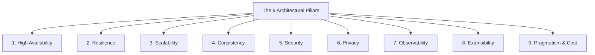
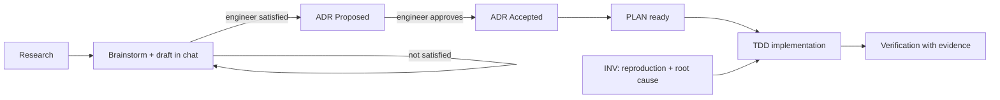
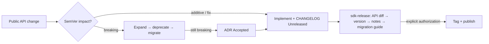

# 🛡️ My Skills, My Rules, My Agents

> **Single Source of Truth (SSOT) Architecture, Skills & Engineering Standards for Autonomous AI Coding Agents**  
> **Repository:** `git@github.com:huydoansg/my-skills-my-rules-my-agents.git`

This repository houses a comprehensive, battle-tested system of **Engineering Rules**, **Tech Conventions**, **Progressive Skills**, and **Architectural Templates** tailored for autonomous coding assistants: **Antigravity (AGY)**, **Claude (Claude Code)**, **OpenAI Codex / Copilot**, **Cursor**, and **Windsurf**.

Besides coding standards it ships a **gated engineering workflow** (research → ADR → plan → implement → verify) that is *chat-first*: the engineer and the agent settle the design in the chat window, and documents are written only after that.

---

## 🏗️ Repository Architecture

```text
my-skills-my-rules-my-agents/
├── AGENTS.md                              # Master entrypoint for Antigravity & Agent tools
├── CLAUDE.md -> AGENTS.md                 # Symlink entrypoint for Claude Code
├── .cursorrules -> AGENTS.md              # Symlink entrypoint for Cursor
├── .github/
│   └── copilot-instructions.md            # Entrypoint for GitHub Copilot & OpenAI Codex
├── install.sh                             # Automated installer / sync tool for any project
│
├── core/                                  # Universal foundational rules
│   ├── 00-agent-manifesto.md              # Principal Engineer persona & operating rules
│   ├── 01-solid-dry-clean-code.md         # SOLID, DRY, and Clean Architecture boundaries
│   ├── 02-architectural-pillars.md        # The 9 Architectural Pillars & Scorecard
│   ├── 03-verification-loop.md            # Mandatory test, linter & typecheck loop
│   ├── 04-documentation-and-diagrams.md   # C4 Model & Mermaid diagram specifications
│   ├── 05-logging-and-observability.md    # Structured JSON logging, PII masking & 5 checkpoints
│   ├── 06-technical-writing-and-evidence-grounding.md # Anti-wall-of-text, tables, alerts & anti-hallucination
│   ├── 07-workflow-governance.md          # Gates, approval, revision, status updates, evidence
│   ├── 08-repo-layout-and-naming.md       # .agents/ vs .docs/, artifact locations, naming
│   ├── 09-language-and-communication.md   # Chat in engineer's language, documents in English
│   └── 10-visual-communication.md         # Diagram encoding, palette, legend, highlighting & text emphasis
│
├── workflow/
│   └── workflow.md                        # research -> ADR -> plan -> implement -> verify (chat-first)
│
├── snippets/
│   └── agents-policy.md                   # Policy block appended to a project's existing AGENTS.md
│
├── conventions/                           # Deep, stack-specific conventions
│   ├── aws/conventions.md                 # Well-Architected, IAM least privilege, CDK/Terraform
│   ├── typescript-javascript/conventions.md # Strict types, Zod, ESM, async/await
│   ├── react/conventions.md               # Modern hooks, component separation, render optimization
│   ├── rust/conventions.md                # Idiomatic Rust, Clippy, error handling, Tokio
│   ├── python/conventions.md              # Modern type hints, Pydantic v2, Ruff, Asyncio
│   ├── golang/conventions.md              # Standard layout, error wrapping, context, concurrency
│   ├── postgresql/conventions.md          # Schema modeling, covering indexes, zero-downtime DDL
│   ├── docker/conventions.md              # Multi-stage builds, non-root, distroless, layer caching
│   ├── kubernetes/conventions.md          # Probes, guaranteed QoS, PSS restricted, NetworkPolicy
│   ├── gitops/conventions.md              # ArgoCD/Flux, Kustomize overlays, SOPS/Sealed Secrets
│   ├── electron/conventions.md            # Hardened security (sandbox, contextIsolation), IPC
│   ├── tauri/conventions.md               # Tauri v2 capabilities, Rust IPC commands, state
│   └── sdk-library/conventions.md         # SemVer, backward compatibility, deprecation, changelog & release docs
│
├── skills/                                # On-demand workflows (Progressive Disclosure)
│   ├── requirement-discovery/SKILL.md     # (optional) clarify large requirements in chat, then REQ files
│   ├── architecture-design/SKILL.md       # Research + chat draft -> ADR (gated)
│   ├── implementation-planning/SKILL.md   # Accepted ADR -> executor-ready PLAN
│   ├── investigate-bugfix/SKILL.md        # Reproduce -> root cause -> TDD fix (no blind fixes)
│   ├── implementation-verification/SKILL.md # Evidence-based VER report, status proposals
│   ├── sdk-api-evolution/SKILL.md         # Change a public API without breaking consumers
│   ├── sdk-release/SKILL.md               # SemVer bump, changelog, release notes, migration guide
│   ├── arch-designer/SKILL.md             # System design workflow with 9 pillars & C4 diagrams
│   ├── tech-writer/SKILL.md               # High-signal technical documentation & diagram crafting
│   ├── log-investigator/SKILL.md          # Log-driven incident investigation & root cause discovery
│   ├── aws-architect/SKILL.md             # AWS solution design, Well-Architected & FinOps
│   ├── k8s-gitops-deployer/SKILL.md       # Production K8s manifests & ArgoCD pipelines
│   ├── rust-optimizer/SKILL.md            # Rust performance profiling & safety auditing
│   ├── postgres-tuner/SKILL.md            # Query optimization & EXPLAIN ANALYZE tuning
│   ├── desktop-app-hardening/SKILL.md     # Desktop app security auditing (Electron & Tauri)
│   └── code-auditor/SKILL.md              # Full codebase audit against SOLID, DRY & OWASP
│
└── templates/                             # Production-ready technical templates
    ├── architecture-spec.md               # arc42 + C4 System Design Specification
    ├── adr.md                             # ADR = SAD for one topic (invariants, principles/rules)
    ├── plan.md                            # Executor-ready plan (EARS AC, TDD phases, verification plan)
    ├── investigation.md                   # Bug report: reproduction, hypotheses, root cause, fix plan
    ├── requirement.md                     # Requirement analysis (optional)
    ├── verification.md                    # Verification report with evidence table
    ├── developer-guidelines.md            # Skeleton for a project runbook
    ├── pr-description.md                  # Pull Request template with verification checklist
    ├── changelog.md                       # Keep a Changelog 2.0.0 skeleton with Breaking markers
    ├── release-notes.md                   # Per-version release notes with diagrams
    ├── migration-guide.md                 # Major-version migration guide (before/after, search patterns)
    ├── sdk-versioning-policy.md           # Public versioning, deprecation & support policy
    └── incident-postmortem.md             # Blameless postmortem template
```

---

## 🏛️ The 9 Architectural Pillars (Non-Negotiable)

Every architectural decision and system design proposed by an AI agent must score compliance against these 9 pillars:



1. **High Availability (HA)**: Zero SPOF, Multi-AZ deployments, automated health checks (99.9%+ SLA).
2. **Resilience**: Timeouts, circuit breakers, exponential backoff with jitter, dead-letter queues (DLQ).
3. **Scalability**: Stateless services, horizontal elasticity, Cache-Aside caching, indexed queries.
4. **Consistency**: Explicit ACID vs. BASE boundaries, Transactional Outbox pattern, Idempotency keys.
5. **Security**: Zero Trust, Least Privilege IAM, TLS 1.3 / mTLS, KMS encryption at rest, OWASP defense.
6. **Privacy**: Data minimization, PII masking in application logs, audit logs for sensitive reads.
7. **Observability**: OpenTelemetry distributed tracing, structured JSON logs, actionable alerts.
8. **Extensibility**: Modular architecture, pluggable event listeners, feature flags.
9. **Pragmatism & Cost**: Right-sized infrastructure, avoiding premature microservices, FinOps awareness.

---

## 🚀 How to Install / Sync to Any Project

Use the built-in `install.sh` script to configure rules and skills for any target repository:

### 1. Link into a Specific Project (Recommended for Active Development)
```bash
# Example: Install full stack or selected stacks using symlinks
./install.sh \
  --target /path/to/my-awesome-project \
  --stacks typescript-javascript,react,docker,postgresql
```

### 2. Copy Mode (For Standalone Repositories)
```bash
./install.sh \
  --target /path/to/my-desktop-project \
  --stacks rust,tauri,postgresql \
  --mode copy
```

### 3. Workflow and `.docs/` skeleton
`install.sh` always installs `.docs/workflow.md` (the skills refer to it). Add `--with-docs`
to create `.docs/{adr,plans,research,requirements,investigations,verifications}` with index
files; existing files are never overwritten. If the target already has an `AGENTS.md`, the
installer appends the *Enterprise* block and the workflow policy block
(`snippets/agents-policy.md`) once, between `<!-- BEGIN/END my-skills-policy -->` markers.
Symlink mode uses absolute paths and breaks on another machine; use `--mode copy` for
portable repositories.

### 4. Global Installation for Antigravity CLI
```bash
# Mounts skills globally for all workspaces run by Antigravity on your machine
./install.sh --global
```

---

## 🔁 Engineering Workflow



| Principle | Rule | Defined in |
|---|---|---|
| **Chat first, document later** | No ADR/plan files while the design is still moving; saves tokens | `core/07` |
| **Hard gates** | Feature = ADR `Accepted` + PLAN `ready`; bug fix = reproduction + root-cause evidence | `core/07` |
| **Evidence & status discipline** | Claims cite file/line or command output; status changes are proposed, then confirmed by the engineer | `core/07` |
| **Language** | Chat in the engineer's language; every written document, comment and commit in English; slang is clarified, not translated | `core/09` |
| **Layout** | `.agents/` = agent tooling, `.docs/` = product & architecture; naming and INDEX rules | `core/08` |

Skills: `requirement-discovery` (optional) → `architecture-design` → `implementation-planning`; `investigate-bugfix` for bugs; `implementation-verification` before claiming done. Details: [`workflow/workflow.md`](workflow/workflow.md).

---

## 📚 SDK & Library Standard

For repositories that publish code others depend on (public or internal SDK, UI component
library, generated client, CLI). Install with `--stacks sdk-library,<language>`. The agent
first establishes the **SDK profile** (audience `internal`/`public`, kind `library`/
`ui-components`/`api-client`/`cli`) and asks when it is unknown.



| Concern | Standard | Defined in |
|---|---|---|
| Profile | Audience (`internal`/`public`) × kind; drives window, support, docs depth | `conventions/sdk-library` §1 |
| Version numbers | Semantic Versioning 2.0.0, Conventional Commits 1.0.0 | §3 |
| Backward compatibility | Public surface, change → bump table, expand/contract, API diff tools per ecosystem | §2, §4, §6 |
| Deprecation | since / replacement / removal / link; window per audience | §5 |
| UI components | Props, a11y, styling hooks, tokens; visual changes classified by impact; visual regression + axe | §2, §3.3, §7 |
| Documentation | Keep a Changelog 2.0.0; release notes and migration guides in one "most important first" skeleton | §8, `templates/` |
| Visuals | Draw only when a picture is clearer; status classes, palette, legend, ≤ 3 highlights | `core/10` |
| Release | Evidence-based bump, dry-run, publish only with authorization | §9, `skills/sdk-release` |

---

## 📦 What Gets Installed Into a Project

```text
<project>/
├── AGENTS.md                 # your project file + appended Enterprise block + workflow policy block
├── CLAUDE.md, .cursorrules   # -> AGENTS.md
├── .github/copilot-instructions.md
├── .agents/
│   ├── rules/                # core/00-09 + conventions/<stack>.md
│   ├── skills/               # all skills
│   └── templates/            # adr, plan, investigation, requirement, verification, ...
└── .docs/
    ├── workflow.md           # always installed
    └── adr/ plans/ research/ requirements/ investigations/ verifications/   # only with --with-docs
```

Project-specific content (commands, architecture boundaries, ADR invariants, local conventions) stays in the project's own `AGENTS.md` and `.docs/`; this repository stays generic.

---

## 🤖 Supported AI Agents & Tool Compatibility

| Agent Tool | Configuration Mechanism | How It Integrates |
|---|---|---|
| **Antigravity (AGY)** | `AGENTS.md` + `.agents/` | Automatically discovers `.agents/rules/` and mounts `.agents/skills/` on demand. |
| **Claude / Claude Code** | `CLAUDE.md` | Symlinked directly to `AGENTS.md`, referencing all core rules and conventions. |
| **Cursor** | `.cursorrules` / `.cursor/rules/` | Symlinked directly to `AGENTS.md`. |
| **GitHub Copilot / Codex** | `.github/copilot-instructions.md` | Pre-configured to read `AGENTS.md` and `conventions/`. |
| **Windsurf** | `.windsurfrules` | Supported via symlink to `AGENTS.md`. |

---

## 🧭 Maintaining This Repository

- Keep every file **generic**: no project names, ADR numbers, product commands or paths that only exist in one project. Use placeholders such as `<check command>`.
- Write in English. New rules/skills carry a `Revision history` entry; revisions are bumped only on the maintainer's confirmation.
- When a project proves a practice worth sharing, generalize it here, then reinstall (symlink mode picks changes up immediately; copy mode needs a re-run of `install.sh`).
- Test installer changes against a throw-away directory (`--target $(mktemp -d)`), twice, to confirm idempotency.
