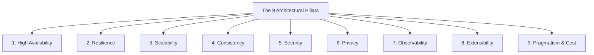

# 🛡️ My Skills, My Rules, My Agents

> **Single Source of Truth (SSOT) Architecture, Skills & Engineering Standards for Autonomous AI Coding Agents**  
> **Repository:** `git@github.com:huydoansg/my-skills-my-rules-my-agents.git`

This repository houses a comprehensive, battle-tested system of **Engineering Rules**, **Tech Conventions**, **Progressive Skills**, and **Architectural Templates** tailored for autonomous coding assistants: **Antigravity (AGY)**, **Claude (Claude Code)**, **OpenAI Codex / Copilot**, **Cursor**, and **Windsurf**.

---

## 🏗️ Repository Architecture

```text
my-skills-my-rules-my-agents/
├── AGENTS.md                              # Master entrypoint for Antigravity & Agent tools
├── CLAUDE.md -> AGENTS.md                 # Symlink entrypoint for Claude Code
├── .cursorrules -> AGENTS.md              # Symlink entrypoint for Cursor
├── .github/
│   └── copilot-instructions.md            # Entrypoint for GitHub Copilot & OpenAI Codex
├── install.sh                             # Automated installer / sync tool for any project
│
├── core/                                  # Universal foundational rules
│   ├── 00-agent-manifesto.md              # Principal Engineer persona & operating rules
│   ├── 01-solid-dry-clean-code.md         # SOLID, DRY, and Clean Architecture boundaries
│   ├── 02-architectural-pillars.md        # The 9 Architectural Pillars & Scorecard
│   ├── 03-verification-loop.md            # Mandatory test, linter & typecheck loop
│   └── 04-documentation-and-diagrams.md   # C4 Model & Mermaid diagram specifications
│
├── conventions/                           # Deep, stack-specific conventions
│   ├── aws/conventions.md                 # Well-Architected, IAM least privilege, CDK/Terraform
│   ├── typescript-javascript/conventions.md # Strict types, Zod, ESM, async/await
│   ├── react/conventions.md               # Modern hooks, component separation, render optimization
│   ├── rust/conventions.md                # Idiomatic Rust, Clippy, error handling, Tokio
│   ├── python/conventions.md              # Modern type hints, Pydantic v2, Ruff, Asyncio
│   ├── golang/conventions.md              # Standard layout, error wrapping, context, concurrency
│   ├── postgresql/conventions.md          # Schema modeling, covering indexes, zero-downtime DDL
│   ├── docker/conventions.md              # Multi-stage builds, non-root, distroless, layer caching
│   ├── kubernetes/conventions.md          # Probes, guaranteed QoS, PSS restricted, NetworkPolicy
│   ├── gitops/conventions.md              # ArgoCD/Flux, Kustomize overlays, SOPS/Sealed Secrets
│   ├── electron/conventions.md            # Hardened security (sandbox, contextIsolation), IPC
│   └── tauri/conventions.md               # Tauri v2 capabilities, Rust IPC commands, state
│
├── skills/                                # On-demand workflows (Progressive Disclosure)
│   ├── arch-designer/SKILL.md             # System design workflow with 9 pillars & C4 diagrams
│   ├── aws-architect/SKILL.md             # AWS solution design, Well-Architected & FinOps
│   ├── k8s-gitops-deployer/SKILL.md       # Production K8s manifests & ArgoCD pipelines
│   ├── rust-optimizer/SKILL.md            # Rust performance profiling & safety auditing
│   ├── postgres-tuner/SKILL.md            # Query optimization & EXPLAIN ANALYZE tuning
│   ├── desktop-app-hardening/SKILL.md     # Desktop app security auditing (Electron & Tauri)
│   └── code-auditor/SKILL.md              # Full codebase audit against SOLID, DRY & OWASP
│
└── templates/                             # Production-ready technical templates
    ├── architecture-spec.md               # arc42 + C4 System Design Specification
    ├── adr.md                             # Architecture Decision Record (ADR)
    ├── pr-description.md                  # Pull Request template with verification checklist
    └── incident-postmortem.md             # Blameless postmortem template
```

---

## 🏛️ The 9 Architectural Pillars (Non-Negotiable)

Every architectural decision and system design proposed by an AI agent must score compliance against these 9 pillars:



1. **High Availability (HA)**: Zero SPOF, Multi-AZ deployments, automated health checks (99.9%+ SLA).
2. **Resilience**: Timeouts, circuit breakers, exponential backoff with jitter, dead-letter queues (DLQ).
3. **Scalability**: Stateless services, horizontal elasticity, Cache-Aside caching, indexed queries.
4. **Consistency**: Explicit ACID vs. BASE boundaries, Transactional Outbox pattern, Idempotency keys.
5. **Security**: Zero Trust, Least Privilege IAM, TLS 1.3 / mTLS, KMS encryption at rest, OWASP defense.
6. **Privacy**: Data minimization, PII masking in application logs, audit logs for sensitive reads.
7. **Observability**: OpenTelemetry distributed tracing, structured JSON logs, actionable alerts.
8. **Extensibility**: Modular architecture, pluggable event listeners, feature flags.
9. **Pragmatism & Cost**: Right-sized infrastructure, avoiding premature microservices, FinOps awareness.

---

## 🚀 How to Install / Sync to Any Project

Use the built-in `install.sh` script to configure rules and skills for any target repository:

### 1. Link into a Specific Project (Recommended for Active Development)
```bash
# Example: Install full stack or selected stacks using symlinks
./install.sh \
  --target /path/to/my-awesome-project \
  --stacks typescript-javascript,react,docker,postgresql
```

### 2. Copy Mode (For Standalone Repositories)
```bash
./install.sh \
  --target /path/to/my-desktop-project \
  --stacks rust,tauri,postgresql \
  --mode copy
```

### 3. Global Installation for Antigravity CLI
```bash
# Mounts skills globally for all workspaces run by Antigravity on your machine
./install.sh --global
```

---

## 🤖 Supported AI Agents & Tool Compatibility

| Agent Tool | Configuration Mechanism | How It Integrates |
|---|---|---|
| **Antigravity (AGY)** | `AGENTS.md` + `.agents/` | Automatically discovers `.agents/rules/` and mounts `.agents/skills/` on demand. |
| **Claude / Claude Code** | `CLAUDE.md` | Symlinked directly to `AGENTS.md`, referencing all core rules and conventions. |
| **Cursor** | `.cursorrules` / `.cursor/rules/` | Symlinked directly to `AGENTS.md`. |
| **GitHub Copilot / Codex** | `.github/copilot-instructions.md` | Pre-configured to read `AGENTS.md` and `conventions/`. |
| **Windsurf** | `.windsurfrules` | Supported via symlink to `AGENTS.md`. |

---

## 📤 Git Remote & Pushing to GitHub

To push this repository to your GitHub account:

```bash
cd /Volumes/W/work/my-skills-my-rules-my-agents
git add .
git commit -m "feat: initialize enterprise AI agent skills and rules repository"
git push -u origin main
```
