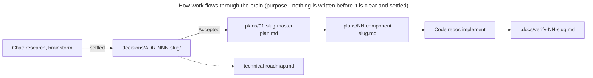

# <Product> — Product Brain

The **Product Brain** is the technical source of truth for <Product>: decisions,
architecture, roadmaps, components and references. It is a separate repository; code
repositories link to it. It does **not** hold the PRD, business documents or source code.

| Path | Holds |
| --- | --- |
| [`architecture.md`](architecture.md) | System-level architecture overview |
| [`product-roadmap.md`](product-roadmap.md) | Product milestones and features → the ADRs that deliver them |
| [`technical-roadmap.md`](technical-roadmap.md) | ADRs in order, status, master plan links |
| [`decisions/`](decisions/README.md) | One folder per ADR: the ADR, its research, contracts, plans, verification |
| [`components/`](components/README.md) | One card per component (role, interfaces, commands) |
| [`references/`](references/README.md) | External source documents |
| [`AGENTS.md`](AGENTS.md) | Rules for agents working in this brain, including its Docs layout |

Setup, structure and conventions: `guides/product-brain.md` in
[my-skills-my-rules-my-agents](https://github.com/huydoansg/my-skills-my-rules-my-agents).
