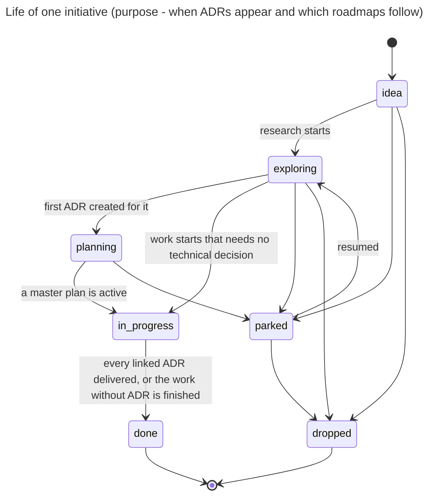

# Initiatives (index)

An **initiative** is an idea the engineer wants to keep and grow: a product idea or a
technology idea. It is not a decision (ADR) and not a plan. It may stay vague; it never
authorizes implementation. Shared roadmap of all initiatives: [`roadmap.md`](roadmap.md).

| Initiative | Title | Type | Status | Horizon | ADRs |
| --- | --- | --- | --- | --- | --- |
| [NNN-DDMMYYYY-slug](NNN-DDMMYYYY-slug/README.md) | … | product · technology | idea · exploring · planning · in-progress · done · parked · dropped | now · next · later · someday | ADR-NNN · none |

## One folder per initiative

```text
NNN-DDMMYYYY-slug/
├── README.md                # initiative card (template: .agents/templates/initiative.md)
├── context.md               # background, constraints, prior art (template: .agents/templates/initiative-context.md)
└── .researchs/<subject>.md  # research notes; may stay inconclusive
```

- `NNN`: global 3-digit number, next free one; check this table **and** the folder list.
  Never reuse a number, even for `dropped` initiatives.
- `DDMMYYYY`: the date the initiative was created. `slug`: lowercase kebab-case, ASCII.
- ADRs stay in `decisions/`; the card links to them and each ADR names the initiative.
- An initiative has 0..n ADRs; an ADR serves 0 or 1 initiative. Work that needs no
  technical decision moves from `exploring` to `in-progress` without an ADR.

## Lifecycle



| Status | Meaning |
| --- | --- |
| idea | captured; little or no research |
| exploring | context and research being gathered; ambiguity expected |
| planning | at least one ADR (Proposed or Accepted) exists for it |
| in-progress | at least one master plan of a linked ADR is `active`, or work that needs no technical decision has started |
| done | every linked ADR is delivered (master plans `done`), or the work without ADR is finished; the card's *Outcome* is filled |
| parked | paused; may resume |
| dropped | will not be done; reason recorded |

## Sync (one change each time, after the engineer confirms)

| Event | Update |
| --- | --- |
| Initiative created, status or horizon changed | Its card (status log), this index, `roadmap.md` |
| First ADR created for it (→ `planning`) | Card ADR table; ADR `Initiative` property; `technical-roadmap.md` (Initiative column); `product-roadmap.md` too when type is `product`; this index; `roadmap.md` |
| Linked ADR Accepted, Rejected or Superseded | Card ADR table; this index |
| Linked master plan active / done | Card status (`in-progress` / `done` when all delivered); this index; `roadmap.md` |
| Work without ADR starts / ends (engineer reports it) | Card status (`in-progress` / `done`) and *Outcome*; this index; `roadmap.md` |
