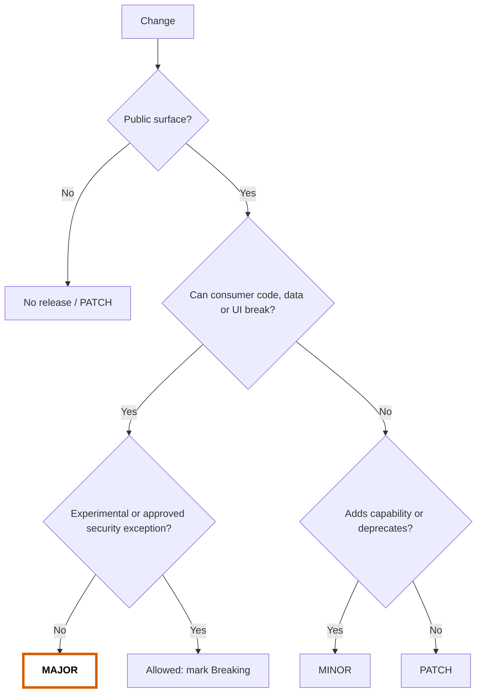
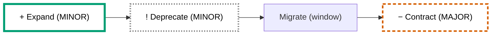
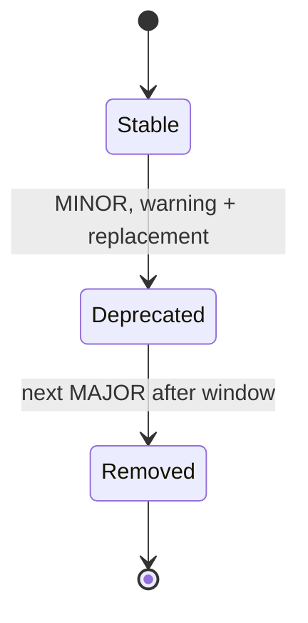

# SDK & LIBRARY: VERSIONING, COMPATIBILITY & RELEASE DOCUMENTATION

For any repository that publishes code others depend on: SDK, shared library, UI component
library, generated API client, CLI, plugin API. Language-agnostic; stack conventions add the
language mechanics. Diagrams and emphasis follow `core/10-visual-communication`.

> [!IMPORTANT]
> **The consumer is the customer.** A change is judged by what it does to code that already
> depends on the SDK, not by the size of the diff.

| Use | Skill / template |
| --- | --- |
| Changing the public API | [`sdk-api-evolution`](../../skills/sdk-api-evolution/SKILL.md) |
| Cutting a version | [`sdk-release`](../../skills/sdk-release/SKILL.md) |
| Docs | `changelog.md`, `release-notes.md`, `migration-guide.md`, `sdk-versioning-policy.md` |

Standards (accessed 2026-10-23): [SemVer 2.0.0](https://semver.org/spec/v2.0.0.html) ·
[Keep a Changelog 2.0.0](https://keepachangelog.com/en/2.0.0/) (2026-06-07) ·
[Conventional Commits 1.0.0](https://www.conventionalcommits.org/en/v1.0.0/) ·
[Google AIP-180/181](https://google.aip.dev/180) · PEP 440/387/702 ·
[Cargo SemVer guide](https://doc.rust-lang.org/cargo/reference/semver.html) ·
[Go modules](https://go.dev/ref/mod). An ecosystem's stricter rule wins and is recorded in
the versioning policy.

---

## 1. SDK profile (set first)

Before classifying any change, the agent loads the profile from the header of
`.docs/sdk/versioning-policy.md`. **If it is missing, ask the engineer in chat; never
guess.** Record the answer there and add one line to the project `AGENTS.md`:
`SDK profile: <audience>/<kind>, see .docs/sdk/versioning-policy.md`.

| Axis | Values | What it changes |
| --- | --- | --- |
| **Audience** | `internal` (other teams/repos install it) · `public` | Window, support, supply chain, docs depth (table below) |
| **Kind** | `library` · `ui-components` · `api-client` · `cli` | Extra contract surfaces and checks (section 2, section 7) |

Both audiences use **full SemVer**: an internal package installed by other repos breaks them
exactly like a public one.

| Concern | `internal` | `public` |
| --- | --- | --- |
| Deprecation window (reference, confirm per project) | ≥ 1 MINOR **and** 3 months | ≥ 1 MINOR **and** 6 months |
| Supported major lines | Current; previous on request | Current + previous (maintenance) |
| Security fixes | Patch on current line; notify consumers | Patch on all supported lines + advisory |
| Provenance / signing / SBOM | Recommended | Required |
| Docs | README, CHANGELOG, migration guides, API reference | All of internal + release notes, guides, versioning policy page; `llms.txt` optional |

## 2. Public surface

Anything observable and not marked internal is public (*Hyrum's Law*). Hide internals with
the language mechanism (`internal/`, `_private`, `@internal`, `#[doc(hidden)]`, not in
`exports`), not with a comment.

| Surface | All kinds | Extra for `ui-components` |
| --- | --- | --- |
| **API** | Exported symbols, signatures, types, generics, enums, constants | Props and their types/defaults, events/callbacks, slots/children, subcomponents |
| **Behavior** | Defaults, error types/codes, ordering, retries, idempotency | States and interactions (disabled, loading, focus, keyboard) |
| **Accessibility** | — | ARIA roles/attributes, focus order, labelling, screen-reader output |
| **Styling hooks** | — | Published class names, `data-*` attributes, `::part`, CSS custom properties, design tokens |
| **Visual output** | — | Layout, hierarchy, spacing, color, typography (classified in section 3.3) |
| **Wire / data** | Request/response schemas, serialized formats, config keys, env vars, CLI flags, exit codes | — |
| **Platform** | Runtime/compiler minimum, OS, arch | Peer framework range, browsers, SSR/hydration |
| **Packaging** | Package name, import path, entry points, `exports` map | CSS entry points, theme packages |

Not covered unless the policy says so: undocumented DOM structure, error message text, log
text, `experimental`/`preview` symbols (always still listed in the changelog).

Stability levels per symbol: `stable` (default, MAJOR only) · `beta` (may change in MINOR,
announced) · `experimental` (any release, announced) · `deprecated` · `internal`.

## 3. Versioning (SemVer 2.0.0)

### 3.1 Decide the bump

Compare against the **last published release**. The required bump is the maximum over all
changes.

### 3.2 Change → bump

| Change | Bump | Compatible alternative |
| --- | --- | --- |
| Remove/rename symbol, option, flag, prop | MAJOR | Deprecate first (section 5) |
| Add a **required** parameter/field/prop | MAJOR | Optional with a safe default |
| Incompatible type change (param, return, prop) | MAJOR | New function/prop |
| Change a default or documented behavior | MAJOR | Opt-in flag in MINOR, flip in MAJOR |
| New error type callers cannot catch generically | MAJOR | Subtype of an existing error |
| Add method to an interface consumers implement | MAJOR | Default implementation |
| Add variant to an exhaustively matched enum/union | MAJOR | Declare non-exhaustive up front |
| Add field to a literal-constructible struct (Rust, Go) | MAJOR | `#[non_exhaustive]`, constructors, options |
| Drop a runtime/platform version | MAJOR | MINOR only if the policy says EOL runtimes drop in MINOR |
| Raise a peer dependency major; expose a third-party type | MAJOR | Wrap third-party types |
| Wire format: remove/rename field, reuse protobuf number | MAJOR | Additive fields; `reserved` numbers |
| Add symbol, optional parameter, option, field, prop | MINOR | — |
| Deprecate; promote `beta` → `stable` | MINOR | — |
| Fix behavior to match docs | PATCH | MAJOR or opt-in if widely relied upon |
| Performance, internal refactor, non-exposed dependency bump | PATCH | — |
| Security fix | PATCH | If it must break: approved exception, `Security` + `**Breaking:**` + advisory |

### 3.3 UI components: visual and accessibility changes

| Change | Bump | Label |
| --- | --- | --- |
| Minor visual tweak (color shade, radius, shadow) within the design intent | PATCH or MINOR | `visual-change` + before/after screenshot |
| New variant, size, token, slot, optional prop | MINOR | — |
| Layout or visual hierarchy breaks (size, spacing, stacking that shifts surrounding UI) | MAJOR | `visual-change`, `migration-required` |
| Intentional change to a token's output value | MAJOR | `visual-change` |
| Rename/remove a published class, `data-*`, `::part`, CSS variable | MAJOR | `migration-required` |
| Accessibility behavior change (roles, focus order, keyboard) | MAJOR unless it fixes a WCAG defect (then PATCH + `a11y-impact`) | `a11y-impact` |

A project may override this table in its versioning policy. Labels: `low-risk`,
`visual-change`, `a11y-impact`, `migration-required`.

### 3.4 Version rules

1. Format `MAJOR.MINOR.PATCH[-alpha.N|-beta.N|-rc.N]`; Python maps to PEP 440 (`1.4.0rc1`).
2. `0.y.z`: `0.MINOR` is the breaking position. Publish `1.0.0` once real consumers depend on it.
3. **Published versions are immutable.** Yank/deprecate in the registry, mark `[YANKED]`, ship a PATCH.
4. One version source of truth (the manifest); everything else is generated or CI-checked.
5. Tags `vX.Y.Z`; monorepos `<pkg>/vX.Y.Z` or `<pkg>@X.Y.Z` (policy picks one). Go major ≥ 2 → module path `/vN`.
6. Maintained older majors live on `release/vN.x`; fix on `main`, then backport.

### 3.5 Commits (Conventional Commits 1.0.0)

`fix` → PATCH · `feat` → MINOR · `!` or `BREAKING CHANGE:` footer → MAJOR (MINOR in `0.y`) ·
`docs`/`test`/`refactor`/`build`/`ci`/`chore` → none. Scope = package. Generated changelog
drafts are raw material; the agent curates, the engineer confirms.

## 4. Backward compatibility: evolve, do not break

Default path for anything that would break: **expand → deprecate → migrate → contract**.

Legend: `+` added · `!` deprecated · `−` removed

| Do | Do not |
| --- | --- |
| Options objects, builders, functional options; new params optional | Insert or reorder positional parameters |
| New behavior behind an opt-in flag; flip default in MAJOR | Silently change defaults |
| Extensible enums/structs from day one | Assume consumers never match exhaustively |
| Tolerant reader: ignore unknown fields | Remove/rename wire fields, reuse protobuf numbers |
| Wrap third-party types | Expose dependencies in public signatures |
| Descriptive new name for new behavior | `fooV2`, `fooNew` |

Proof, not intent: **contract tests** that use only the public API stay unchanged across
MINORs (editing them means the change is breaking); **golden files** for wire formats incl.
old fixtures; **examples and doc snippets** run in CI. For UI: stories per state, visual
regression, axe checks (section 7).

## 5. Deprecation

Every deprecation states, in code **and** docs: **since** · **replacement** · **removal
target** · **migration link**. Window: section 1. Earlier removal needs an ADR.

| Language | Mechanism |
| --- | --- |
| TypeScript/JS | `/** @deprecated Since 2.4.0. Use {@link fetchAll}. Removal: 3.0.0. */`; UI: dev-only console warning |
| Python | `@warnings.deprecated` (3.13+, PEP 702) / `typing_extensions.deprecated`; `warnings.warn(..., DeprecationWarning, stacklevel=2)` |
| Rust | `#[deprecated(since = "2.4.0", note = "use fetch_all; removal in 3.0.0")]` |
| Go | `// Deprecated: Use FetchAll instead. Removal in v3.` |
| Java/Kotlin | `@Deprecated(since = "2.4.0", forRemoval = true)`; Kotlin `ReplaceWith` |
| C# | `[Obsolete("Use FetchAll. Removal in 3.0.0.")]` |
| HTTP API | `Deprecation` (RFC 9745) and `Sunset` (RFC 8594) headers |

## 6. Automated compatibility gates

CI diffs the API against the last release; the proposed version must be ≥ the reported
bump. Verify a tool is in the project manifest before relying on it (`core/06` §3.2). Tools
miss behavioral and visual breaks; the agent classifies those with section 3.

| Ecosystem | API / compatibility | Packaging | Release automation (pick one) |
| --- | --- | --- | --- |
| TypeScript/JS | `@microsoft/api-extractor` report diff | `publint`, `@arethetypeswrong/cli` | changesets, release-please, semantic-release |
| Go | `gorelease` (experimental), `apidiff` | `go vet` | release-please, goreleaser |
| Rust | `cargo-semver-checks`, `cargo-public-api` | `cargo publish --dry-run` | release-plz, release-please |
| Python | `griffe check` | `python -m build` + `twine check` | release-please, python-semantic-release |
| Java/Kotlin | `japicmp`, `revapi`, binary-compatibility-validator | — | release-please, JReleaser |
| .NET | Package validation (`EnablePackageValidation`) | `dotnet pack` | release-please |
| Protobuf / OpenAPI / GraphQL | `buf breaking` / `oasdiff breaking` / `graphql-inspector diff` | — | — |

## 7. UI component checks

| Check | Tool examples | Gate |
| --- | --- | --- |
| Living docs per state/variant | Storybook stories | Every public prop/state has a story |
| Visual regression | Playwright `toHaveScreenshot`, Chromatic | Diffs reviewed; accepted diffs → `visual-change` entry |
| Accessibility | axe (`@axe-core/playwright`, Storybook a11y) | No new violations |
| Styling hooks | Snapshot of published class/part/variable names | Removal/rename ⇒ MAJOR |
| Large MAJOR migrations | Codemods (jscodeshift, ts-morph) | Provide when a pattern is widespread; ~70% coverage is still worth it |

Pictures of UI changes are **before/after screenshots**; Mermaid is for flows and structure.

## 8. Documentation

### 8.1 Doc set

| Artifact | Location | When |
| --- | --- | --- |
| `README.md` | Package/repo root | Install, quickstart, link to policy |
| `CHANGELOG.md` | Root (template `changelog.md`) | Same PR as every user-visible change, under `Unreleased` |
| Release notes | `.docs/sdk/releases/vX.Y.Z.md`, reused as release page (template `release-notes.md`) | Every MINOR/MAJOR |
| Migration guide | `.docs/sdk/migrations/vN-to-vM.md` (template `migration-guide.md`) | Before every MAJOR |
| Versioning & support policy | `.docs/sdk/versioning-policy.md` (template `sdk-versioning-policy.md`) | Setup; when policy changes |
| API reference | Generated from doc comments | With the code |

Root `README.md`/`CHANGELOG.md`/`LICENSE`/`SECURITY.md` are the registry exception to
`core/08`. Doc comments carry: summary · params · returns · errors · example · `since`
(`Unreleased` until release) · stability · deprecation.

### 8.2 Document structure: same skeleton, most important first

Every per-version document (release notes, migration guide) uses this order so readers and
agents always know where to look:

1. **Header table:** version · date · **action required: yes/no** · effort · breaking count · labels
2. **Action required:** numbered steps, or "None"
3. **Breaking** (each links to its migration section)
4. **Deprecated** (replacement + removal target)
5. **New**
6. **Fixed**
7. **Links:** changelog, ADRs, PRs

`CHANGELOG.md` keeps Keep a Changelog's fixed type order; release notes and migration guides
use the impact order above. Stable anchors, one topic per section, version numbers in text
(never "the new API").

| Reader | Path |
| --- | --- |
| Skimmer (30 s) | Header table → Action required |
| Upgrader | Breaking → migration guide sections |
| Agent | Anchors + search patterns + `diff` blocks in the migration guide |

### 8.3 Writing a change

- Every entry: **symbol** + verb + consumer effect, 1–2 sentences. Lead with the action.
- Every breaking change answers: **what** changed · **who** is affected · **why** · **how** to
  migrate (`diff` before/after) · how to **detect** (build error, runtime error, silent).
- Value changes: `timeout ~~30 s~~ → <ins>60 s</ins>`. Emphasis rules: `core/10` §8.
- Draw a diagram only per `core/10` §1, with status classes and a legend (`core/10` §3–5).
  Do not pre-fill diagrams in templates.

## 9. Release process

```mermaid
flowchart LR
    accTitle: Release flow
    accDescr: From unreleased changes to an authorized publish.
    U["Unreleased + commits"] --> D["API diff"] --> K["Classify + bump"] --> P["Propose in chat"]
    P -->|confirmed| W["Write docs, stamp version"] --> V["Verify + dry-run"]
    V -->|explicit authorization| R["`**Tag + publish**`"]
    classDef gate fill:#FFFFFF,stroke:#D55E00,stroke-width:4px,color:#000000
    class R gate
```

> [!CAUTION]
> **Publishing is irreversible.** Agents prepare releases; tagging, pushing tags and
> publishing need the engineer's explicit authorization for that version in the session.

Breaking changes need an `Accepted` ADR before implementation (`core/07`). Public SDKs
publish from CI with provenance (npm `--provenance`, PyPI trusted publishing, Sigstore).

## 10. Checklists

**Per change**
- [ ] Profile known; surface touched listed; bump classified with reason (§3).
- [ ] Breaking: compatible alternative considered; ADR `Accepted`; `!` / `BREAKING CHANGE:`.
- [ ] Deprecations carry since / replacement / removal / link.
- [ ] `CHANGELOG.md` `Unreleased` updated; `**Breaking:**` and UI labels where applicable.
- [ ] Contract tests unchanged; API diff output attached; UI: visual + axe checks.

**Per release**
- [ ] Version = max required bump, confirmed; SSOT, tag format, `since` placeholders stamped.
- [ ] Changelog moved and dated; release notes (MINOR/MAJOR) and migration guide (MAJOR) follow §8.2.
- [ ] Diagrams only where `core/10` §1 applies; legend present; screenshots for visual changes.
- [ ] Verification, docs/examples build, dry-run publish pass with evidence.
- [ ] Tag/publish only after explicit authorization.

## 11. Revision history

- rev 0: (draft) SDK/library versioning, compatibility, deprecation, release and documentation convention; SDK profile, UI components, document skeleton; visuals delegated to `core/10`.
