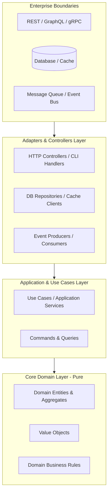

# SOLID, DRY & CLEAN CODE STANDARDS

## 1. THE SOLID PRINCIPLES (STRICT INTERPRETATION)

### S — Single Responsibility Principle (SRP)
- A function, class, or module must have one, and only one, reason to change.
- **Rule of Thumb**:
  - Functions: Maximum 25-30 lines. Must do one thing well at a single level of abstraction.
  - Source Files: Maximum 250-300 lines. If larger, decompose into cohesive submodules.
  - Never mix HTTP orchestration, business validation, and direct database queries in the same function.

### O — Open / Closed Principle (OCP)
- Software entities should be open for extension, but closed for modification.
- **Rule of Thumb**:
  - Replace massive `switch` or `if/else` ladders with Strategy Pattern, Polymorphism, or Dictionary/Map dispatching.
  - Use interfaces or abstract contracts so new business behaviors can be plugged in without editing legacy core logic.

### L — Liskov Substitution Principle (LSP)
- Derived types must be completely substitutable for their base types without altering system correctness.
- **Rule of Thumb**:
  - Never throw `NotImplementedException` or `UnsupportedOperationException` in a subclass.
  - Maintain identical behavioral contracts, pre-conditions, and post-conditions across implementations.

### I — Interface Segregation Principle (ISP)
- Clients should not be forced to depend on interfaces they do not use.
- **Rule of Thumb**:
  - Prefer many small, client-specific interfaces (e.g., `Reader`, `Writer`, `Closer` in Go) over monolithic interfaces (e.g., `IUserManager` with 40 methods).

### D — Dependency Inversion Principle (DIP)
- High-level modules must not depend on low-level modules. Both must depend on abstractions.
- **Rule of Thumb**:
  - Always inject dependencies (DI). Never instantiate database clients, network callers, or filesystem handlers inside domain entities or use cases.

---

## 2. DRY (DON'T REPEAT YOURSELF) VS. ACCIDENTAL DUPLICATION

1. **True Duplication (Domain Knowledge)**:
   - When the business logic or knowledge representation is duplicated in two places, changes to business rules require modifying both. **This must be eliminated immediately.**
2. **Accidental Duplication (Incidental Similarity)**:
   - Two blocks of code look similar today but evolve for different reasons (e.g., `UserRegistrationDTO` vs. `AdminUpdateUserDTO`). **Do not prematurely abstract them together.**
3. **The Rule of Three**:
   - Write once. Copy once if necessary. Abstract only on the third occurrence when the pattern is stable.

---

## 3. CLEAN ARCHITECTURE BOUNDARIES

- **Domain Layer**: Must be pure business logic. Zero dependencies on external frameworks, databases, or UI libraries.
- **Application Layer**: Orchestrates use cases and commands. Calls abstractions/interfaces.
- **Adapters Layer**: Implements abstractions (e.g., PostgreSQL repository implementing `UserRepository` interface).
- **Dependency Direction**: Always flows inward toward the Domain.
