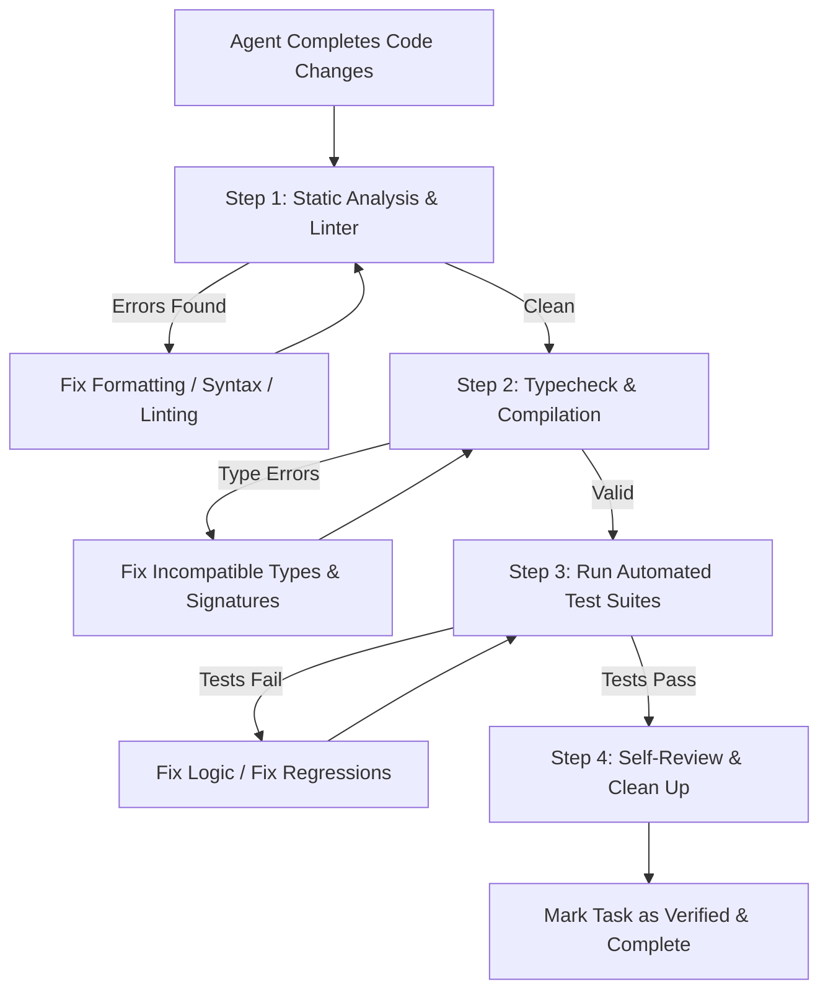

# THE AGENT VERIFICATION LOOP

An AI Agent must never conclude a task with assumptions. Every modification must be validated against a strict verification pipeline.

## MANDATORY STEPS BEFORE SUBMITTING

1. **Step 1: Code Quality & Linting**:
   - Run the project's linter and code formatter (e.g., `eslint`, `biome`, `cargo clippy`, `ruff`, `golangci-lint`).
   - Fix all warnings and errors. Zero warnings tolerated.

2. **Step 2: Type Checking & Compilation**:
   - Run the compiler or strict typechecker (e.g., `tsc --noEmit`, `cargo check`, `pyright`, `go vet`).
   - Ensure all type contracts match.

3. **Step 3: Automated Testing & Edge Cases**:
   - Execute existing tests to verify no regressions were introduced.
   - Write new unit and integration tests covering:
     - The Happy Path.
     - Edge Cases (empty inputs, null/nil handling, boundary values).
     - Error Paths (downstream failure, timeout, invalid payload).

4. **Step 4: Self-Review & Hygiene**:
   - Inspect git diff: verify no console logs, temporary debug flags, unformatted files, or exposed secrets are left behind.
   - Verify all comments and docstrings maintain integrity.
