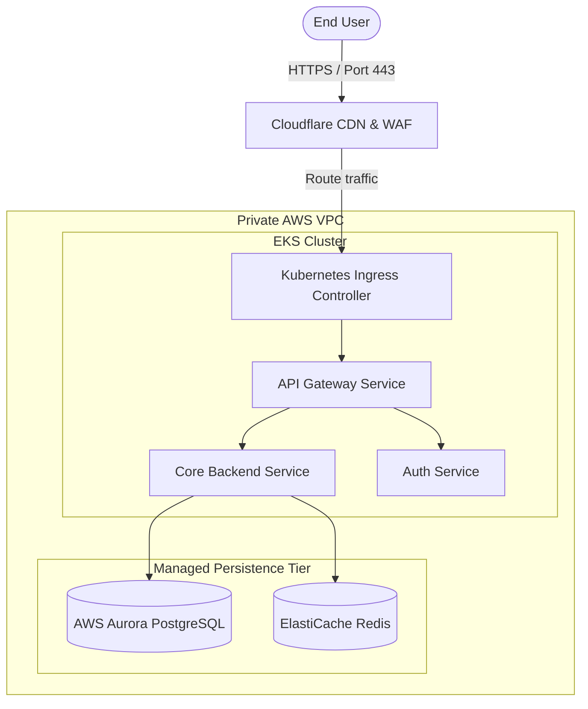
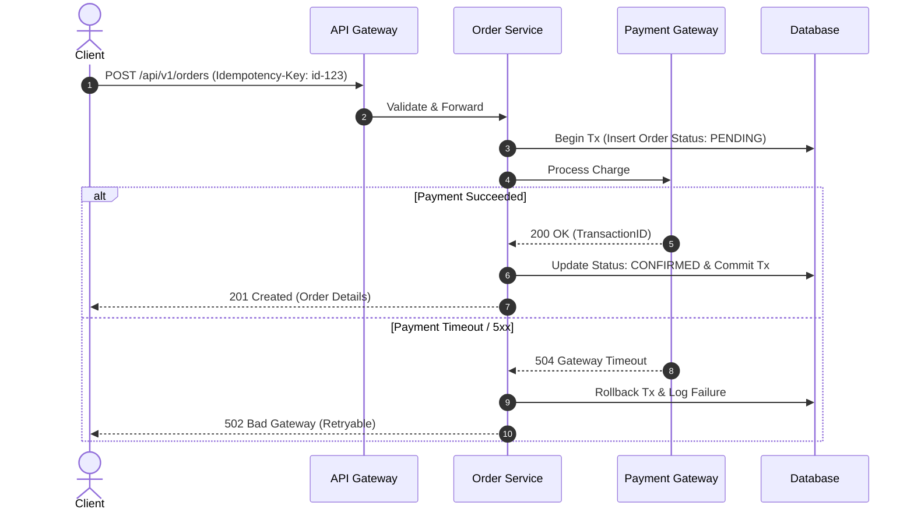
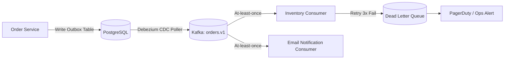
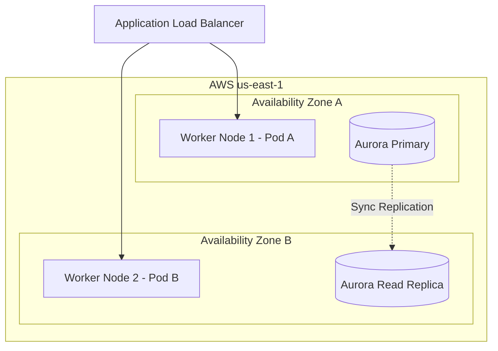

# ARCHITECTURE DOCUMENTATION & MERMAID DIAGRAM STANDARDS

Architecture documentation must be concise, punchy, and diagram-driven. Long-winded prose is discouraged.

## 1. THE 4 MANDATORY ARCHITECTURE VIEWS

Every system design document must include the following 4 views rendered with standard **Mermaid** syntax:

### 1. Static View (C4 Model - System Context & Containers)
- Purpose: Show external actors, third-party integrations, and core software containers.
- Mermaid Type: `graph TD` or `flowchart TD`

### 2. Dynamic View (Sequence Diagram - Business Flow & Failure Paths)
- Purpose: Show step-by-step communication across services, including error and timeout paths.
- Mermaid Type: `sequenceDiagram`

### 3. Integration View (Async Events & Message Queues)
- Purpose: Show pub/sub topologies, event brokers, dead-letter queues, and consumers.
- Mermaid Type: `flowchart LR`

### 4. Deployment & Infrastructure View
- Purpose: Show network subnets, multi-availability zones, container pods, and CI/CD promotion.
- Mermaid Type: `graph TB`

---

## 2. MERMAID SYNTAX RULES FOR AGENTS
1. Quote all node labels containing special characters, brackets, or parentheses: `node["Label (v1.2)"]`.
2. Do not use raw HTML tags inside node text.
3. Keep diagrams legible: decompose into subgraphs when exceeding 10 components.
