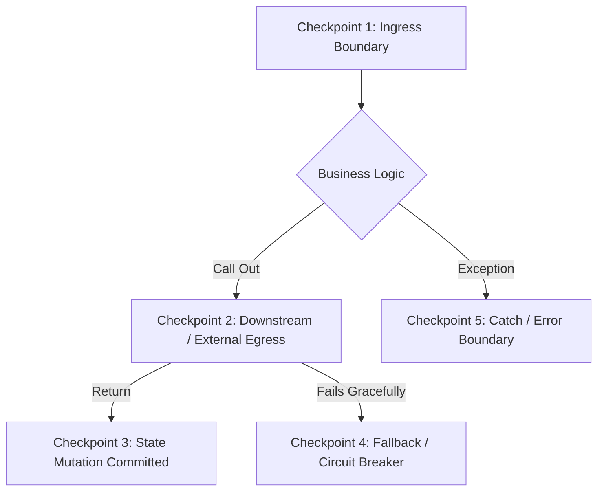

# LOGGING, PII PROTECTION & OBSERVABILITY STANDARDS

Logs are the primary nervous system for production incident investigation. Inadequate logs make debugging impossible, while indiscriminate logging causes severe security breaches and compliance violations (GDPR, PCI-DSS, HIPAA).

Every AI Agent writing code or instrumenting services must strictly enforce this standard.

---

## 1. THE 6 CARDINAL LOGGING PRINCIPLES

1. **Structured JSON by Default**:
   - Never write raw text strings (e.g., `log.info("user created " + user.id)`).
   - Emit machine-parsable JSON with structured key-value pairs.
2. **Contextual Correlation (Traceability)**:
   - Every log within an operation lifecycle must include `trace_id` and `span_id` (OpenTelemetry standard) to enable end-to-end tracing across distributed services.
3. **High Signal-to-Noise Ratio**:
   - Do not log inside high-frequency tight loops (`O(N)` logging in 10,000 iterations).
   - Log significant state transitions and boundaries, not every line of code execution.
4. **Never Log Sensitive Data or Unmasked PII**:
   - Passwords, tokens, API keys, credit cards, and sensitive identity details must be sanitized before logging.
5. **Calibrated Log Levels**:
   - Use the correct log level. Do not mark expected client errors (e.g., HTTP 404, 401) as `ERROR`.
6. **Machine-Readable Event Identifiers**:
   - Include a unique `event` or `event_name` key (e.g., `order.checkout.initiated`, `payment.gateway.timeout`) for automated indexing and alerting.

---

## 2. STANDARD STRUCTURED LOG SCHEMA

Every log entry must adhere to this JSON format:

```json
{
  "timestamp": "2026-10-13T23:45:00.123Z",
  "level": "INFO",
  "service": "order-service",
  "trace_id": "4bf92f3577b34da6a3ce929d0e0e4736",
  "span_id": "00f067aa0ba902b7",
  "event": "order.payment.processed",
  "message": "Payment successfully processed by payment provider",
  "context": {
    "order_id": "ord_89218291",
    "customer_id": "cust_12345",
    "amount_cents": 4900,
    "currency": "USD",
    "gateway": "stripe",
    "duration_ms": 142
  }
}
```

---

## 3. LOG LEVELS HIERARCHY & USAGE CRITERIA

| Level | When to Use | Volume in Prod | Alert Trigger? | Example |
|---|---|---|---|---|
| **DEBUG** | Detailed diagnostic data for developers during local development or temporary staging troubleshooting. | **Disabled** or minimal | No | Query execution plan, raw byte count, internal loop state. |
| **INFO** | Normal, significant business milestones and lifecycle events. | Moderate (< 5-10 per request) | No | `user.registered`, `order.created`, `batch_job.completed`. |
| **WARN** | Unexpected condition that was **gracefully handled** without failing the user request. | Low | Trend-based | External API retry triggered, cache miss fallback to DB, rate limit at 80%. |
| **ERROR** | Operation **failed**; system could not fulfill the user request. Requires developer investigation. | Very Low | Yes | Unhandled exception, database connection loss, 3rd party API returned 5xx. |
| **FATAL** | System **cannot continue running** and must terminate. | Extreme emergency | Immediate PagerDuty | Application bootstrap failed, missing encryption key, out of disk. |

---

## 4. PII & SENSITIVE DATA REDACTION (STRICT RULES)

### 4.1. Absolute Redaction Blacklist (NEVER LOG)
The following fields must **NEVER** appear in logs in plaintext, URL query strings, or metadata:

| Category | Forbidden Attributes | Action Required |
|---|---|---|
| **Authentication** | `password`, `passwd`, `secret`, `api_key`, `token`, `bearer`, `auth_header`, `session_id`, `cookie` | **Strip completely** or replace with `[REDACTED]` |
| **Financial** | `credit_card`, `card_number`, `pan`, `cvv`, `cvc`, `pin`, `bank_account` | **Strip completely** or mask to last 4 digits (`**** **** **** 1234`) |
| **Government IDs** | `ssn`, `social_security`, `passport`, `national_id`, `tax_id` | **Strip completely** or replace with `[REDACTED]` |
| **Personal Identifiers** | `email`, `phone_number`, `full_name`, `home_address`, `ip_address` | **Pseudonymize / Hash** (e.g., SHA-256 with salt) or mask (`j***@example.com`) |

### 4.2. Safe Logging Checklist
- [ ] Never log raw `request.headers` (contains `Authorization`, `Cookie`). Whitelist only safe headers (`User-Agent`, `X-Request-Id`).
- [ ] Never log raw `request.body` without passing through a sanitization filter.
- [ ] In SQL query logs, ensure parameter values are parameterized (`$1`, `?`) and not interpolated raw strings containing sensitive inputs.
- [ ] In Error logs, do not print un-sanitized command lines containing secrets (`exec("curl -u user:pass ...")`).

---

## 5. THE 5 MANDATORY LOGGING CHECKPOINTS

Agents must place structured logs at exactly these 5 lifecycle checkpoints:



### Checkpoint 1: Ingress Boundary (Receiving external request)
- **Level**: `INFO` (or `DEBUG` for high-throughput health checks)
- **Fields**: `event: request.received`, `http_method`, `route_template` (e.g. `/orders/:id`, NOT `/orders/123`), `trace_id`, `client_id` (hashed).

### Checkpoint 2: External Dependencies (Database, Cache, 3rd Party APIs)
- **Level**: `INFO` on success, `WARN` on retry, `ERROR` on failure.
- **Fields**: `event: downstream.call`, `target_system` (e.g., `stripe`, `redis`), `operation`, `duration_ms`, `status_code`, `retry_attempt`.

### Checkpoint 3: Significant State Mutation
- **Level**: `INFO`
- **Fields**: `event: entity.state_changed`, `entity_type`, `entity_id`, `old_state`, `new_state`, `actor_id`.

### Checkpoint 4: Resilient Fallback / Circuit Breakers
- **Level**: `WARN`
- **Fields**: `event: resilience.fallback_triggered`, `circuit_breaker_name`, `fallback_strategy`, `failure_reason`.

### Checkpoint 5: Error Boundary & Catch Blocks
- **Level**: `ERROR`
- **Fields**:
  - `event`: Specific machine-readable identifier (e.g., `order.checkout.failed`).
  - `error_class`: (e.g., `PaymentGatewayTimeoutException`).
  - `error_message`: Concise explanation of what failed.
  - `stack_trace`: Formatted stack trace (do NOT send to HTTP client; keep in internal logs only).
  - `context`: What domain action was being attempted when the failure occurred.

---

## 6. ANTI-PATTERNS (AGENT FORBIDDEN ACTIONS)

- ❌ **Anti-Pattern 1: The Cryptic Log**:
  `console.log("here")` or `logger.info("success")`  
  *(Why bad: Zero context, zero entity ID, impossible to trace in production)*
- ❌ **Anti-Pattern 2: The Log Dump**:
  `logger.info("Received request:", req)`  
  *(Why bad: Dumps socket references, memory buffers, auth tokens, crashes log collector)*
- ❌ **Anti-Pattern 3: Log & Re-Throw**:
  ```typescript
  // BAD: Generates duplicate log entries across every layer of the call stack
  try { ... } catch (err) {
    logger.error("Failed to query DB", err);
    throw err; // Caught and logged again by caller!
  }
  ```
  *(Solution: Either handle and log at the boundary, OR annotate/wrap error and let the top boundary log once).*
- ❌ **Anti-Pattern 4: Expected Errors as ERROR Level**:
  Logging user input validation failure (400 Bad Request) or user entering wrong password (401) as `ERROR` level.  
  *(Solution: Log as `WARN` or `INFO` with `event: auth.login.rejected`; reserve `ERROR` for system faults).*
