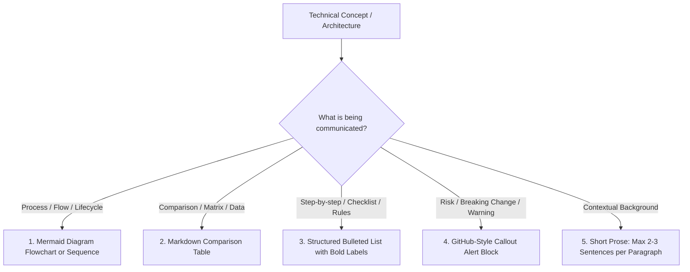

# TECHNICAL WRITING, VISUALIZATION & EVIDENCE GROUNDING STANDARDS

Poor technical documentation wastes developer time, creates false assumptions, and hides critical risks. Long walls of narrative text, lack of diagrams, unhighlighted risks, and hallucinated claims are strictly forbidden.

Every AI Agent authoring specifications, architectural docs, runbooks, or PR summaries must adhere to this standard.

---

## 1. THE "ANTI-WALL-OF-TEXT" HIERARCHY

When presenting information, follow the **Visual-First Hierarchy of Format**:

### Formatting Rules:
1. **Never write more than 3 consecutive sentences of unbroken prose**:
   Break into bullet points, tables, or sub-headers.
2. **The 30-Second Skim Test**:
   An engineer skimming headers, bold keywords, tables, callouts, and Mermaid diagrams must comprehend **80% of the document in under 30 seconds**.
3. **Use Scannable Bold Anchors**:
   In lists, always bold the lead noun/concept:
   - ❌ *Bad*: We should consider that the database must be backed up daily because of data loss.
   -  *Good*: - **Daily Automated Backups**: Retain 7 days of snapshots in S3 to prevent data loss.

---

## 2. STRATEGIC HIGHLIGHTS (CALLOUT ALERTS)

Critical invariants, security risks, breaking changes, and edge-case caveats must **NEVER** be buried inside ordinary paragraphs. They must be hoisted into GitHub-style callouts:

> [!IMPORTANT]
> **Essential Requirements & Invariants**: Must-know architectural constraints or operational prerequisites.

> [!WARNING]
> **Breaking Changes & Latent Risks**: Deprecations, migration blockers, backward-incompatibility risks, or potential performance degradation.

> [!CAUTION]
> **High-Risk Operations**: Data loss, security vulnerabilities, destructive schema migrations, or production downtime risks.

> [!TIP]
> **Optimization & Efficiency**: Performance tuning hints, shortcuts, and developer ergonomics.

---

## 3. EVIDENCE GROUNDING & ANTI-HALLUCINATION RULES

AI models frequently hallucinate code symbols, library methods, line numbers, or performance metrics. **Zero hallucination is tolerated.**

### 3.1. Mandatory Code Citing Rule
- Never mention a function, class, file, or configuration without providing an exact link or verified path.
- In workspace repositories, cite exact file paths and line ranges using GitHub-style markdown links:
  `[UserService.ts#L45-L62](file:///path/to/UserService.ts#L45-L62)`
- If a proposed component does not exist yet, explicitly label it: `[Proposed / New]`.

### 3.2. Zero Phantom APIs or Dependencies
- Never invent methods or library APIs (e.g., using imaginary methods on AWS SDK or standard libraries).
- Before suggesting a third-party package, verify its existence and compatibility in the project's dependency manifest (`package.json`, `Cargo.toml`, `go.mod`, `pyproject.toml`).

### 3.3. No Unsubstantiated Numbers or Metrics
- ❌ *Bad*: "This refactoring makes the system 10x faster and extremely robust."
-  *Good*: "Benchmarking shows query latency reduced from 240ms to 18ms (p95) by utilizing a composite index. `[Verified via EXPLAIN ANALYZE]`"
- If a metric is an engineering estimate rather than measured data, explicitly mark it: `[Estimated Target / Subject to Load Test]`.

---

## 4. COMPARISON TABLES MANDATE

Whenever evaluating two or more alternatives, trade-offs, technologies, or architectures, **never explain them in separate descriptive paragraphs**. Use a **Comparison Matrix Table**:

| Evaluation Criterion | Option A (e.g., Redis Cluster) | Option B (e.g., DynamoDB DAX) | Decision & Rationale |
|---|---|---|---|
| **Latency (p99 Read)** | < 2ms | < 1ms | Redis satisfies our < 5ms requirement. |
| **Operational Overhead** | Moderate (Cluster maintenance) | Low (Fully managed AWS) | DynamoDB preferred for zero-ops. |
| **Cost at Scale** | Fixed instance cost (~$80/mo) | Request-based pricing | Redis is 40% cheaper at 10k RPS. |
| **Pillar Compliance** | Compliant (HA, Resilience) | Compliant (HA, Scalability) | **Chosen: Option A** due to cost & team familiarity. |

---

## 5. EMPHASIS AND DIAGRAM STYLE

The emphasis vocabulary (bold, italic, ~~old~~ → <ins>new</ins>, lists, callout limits) and
the diagram encoding, palette and legend rules are defined once in
[`10-visual-communication`](10-visual-communication.md).

---

## 6. DOCUMENTATION LINT CHECKLIST (BEFORE PUBLISHING)

Before finalizing any technical document, the Agent must execute this self-audit:

- [ ] **No Wall of Text**: Are there any paragraphs longer than 3 sentences? (If yes, decompose into bullets/table).
- [ ] **Visual Completeness**: Are all complex workflows, lifecycles, and network boundaries visualized via Mermaid?
- [ ] **Critical Risks Elevated**: Are all breaking changes and security concerns hoisted into `> [!WARNING]` or `> [!CAUTION]`?
- [ ] **Evidence Verified**: Are all mentioned files, symbols, and line numbers verified against actual code on disk?
- [ ] **No Fluff**: Are generic filler words eliminated ("very robust", "seamlessly", "cutting-edge", "obviously")?
- [ ] **Structured Tables**: Are multiple options or configurations organized into comparison tables?
- [ ] **Visual Language**: Does the `10-visual-communication` self-check pass (legend, ≤ 3 highlights, one meaning per channel)?
