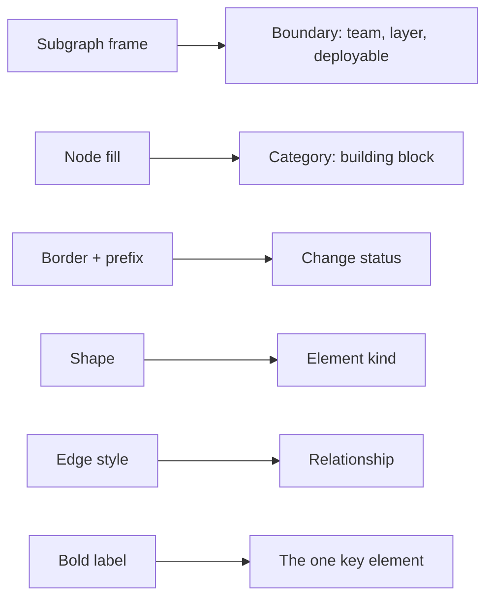
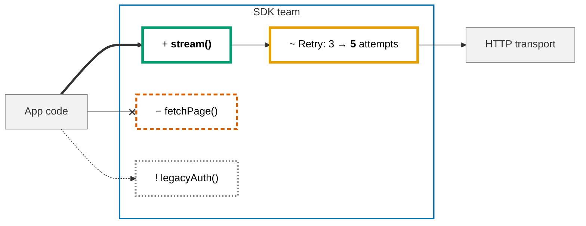

# VISUAL COMMUNICATION: DIAGRAMS & EMPHASIS

One visual language for every document an agent writes. `04` says *which* architecture
views to draw, `06` says *which format* fits the content; this rule says *how* to make a
diagram or a paragraph show what matters.

> [!IMPORTANT]
> **One device = one meaning, used consistently, explained by a legend.**
> If everything is highlighted, nothing is: **at most 3 highlights** per diagram or section.

## 1. When to draw

| Draw a diagram when the reader must understand… | Use instead of a diagram |
| --- | --- |
| A flow or decision path that changed | — |
| Call order between components, incl. failure paths | — |
| A lifecycle (states and transitions) | — |
| Structure: who owns what, layers, dependencies | — |
| A schedule (deprecation, support, rollout) | — |
| A rename, one new parameter, a list of items | Table, bullet list, or a `diff` block |

A diagram that repeats a short list in boxes is noise. Draw only the part that changed,
plus one hop of context.

## 2. Diagram encoding: one channel, one meaning



| Channel | Encodes | Values |
| --- | --- | --- |
| **Subgraph frame** (colored border, no fill) | Boundary: team, layer, deployable, trust zone | One color per boundary |
| **Node fill** (`catA`…`catF`) | Category: building block, component type | Structure diagrams only |
| **Node border + label prefix** | Change status | `added` `+`, `changed` `~`, `removed` `−`, `deprecated` `!`, `context` (muted) |
| **Shape** | Element kind | `["process"]`, `[("store")]`, `{"decision"}`, `(["actor / external"])`, `[["subroutine"]]` |
| **Edge style** | Relationship | `-->` sync call · `-.->` async or optional · `==>` primary or new path · `--x` removed |
| **Bold in label** | The single most important node | One per diagram |

> [!WARNING]
> A node holds **either** a category class **or** a status class, never both: the later
> class overwrites the fill (verified with mermaid-cli 11.4.2). In change diagrams, show
> teams and layers with **subgraph frames** and status with **node classes**.

## 3. Standard palette

Okabe-Ito colors (color-blind safe), explicit text color on every class, borders ≥ 2px so
they survive dark mode. Copy the block; delete the classes you do not use.

```text
%% Palette: core/10-visual-communication (Okabe-Ito)
%% Status: border + label prefix
classDef context    fill:#F2F2F2,stroke:#808080,stroke-width:1px,color:#333333
classDef added      fill:#FFFFFF,stroke:#009E73,stroke-width:4px,color:#000000
classDef changed    fill:#FFFFFF,stroke:#E69F00,stroke-width:4px,color:#000000
classDef removed    fill:#FFFFFF,stroke:#D55E00,stroke-width:3px,stroke-dasharray:6 4,color:#000000
classDef deprecated fill:#FFFFFF,stroke:#808080,stroke-width:3px,stroke-dasharray:2 3,color:#000000
%% Category: fill (structure diagrams)
classDef catA fill:#0072B2,stroke:#003F63,stroke-width:2px,color:#FFFFFF
classDef catB fill:#009E73,stroke:#00573F,stroke-width:2px,color:#FFFFFF
classDef catC fill:#CC79A7,stroke:#7A3D62,stroke-width:2px,color:#000000
classDef catD fill:#E69F00,stroke:#8A5F00,stroke-width:2px,color:#000000
classDef catE fill:#56B4E9,stroke:#1F6E99,stroke-width:2px,color:#000000
classDef catF fill:#D55E00,stroke:#7F3800,stroke-width:2px,color:#FFFFFF
%% Boundary frames: style <SubgraphId> fill:none,stroke:#0072B2,stroke-width:2px
```

Sequence diagrams take `rgb()`/`rgba()`, not hex: frames `box rgba(0,114,178,0.12) Team`,
highlights `rect rgba(0,158,115,0.25)` (added) or `rect rgba(230,159,0,0.25)` (changed).
Solid `box` colors drown the text; keep alpha ≤ 0.15 for frames.

## 4. Legend (mandatory when a diagram uses more than one encoding)

| Encoding used | Legend form |
| --- | --- |
| Change status | One line directly under the diagram: `Legend: + added · ~ changed · − removed · ! deprecated · grey = unchanged` |
| ≥ 3 category colors or boundary colors | `subgraph Legend` with one unconnected sample node per class (chain with `~~~`) |
| Edge styles beyond plain `-->` | Add them to the one-line legend: `==> new path · -.-> async · --x removed` |

## 5. Highlighting a change: worked example

Diagram title: **Paging in v3.** Shows what callers must switch to.



Legend: `+` added · `~` changed · `−` removed · `!` deprecated · grey = unchanged · `==>` new path · `--x` removed call

Techniques shown: status classes, prefixes so meaning never depends on color, one bold
node, old → **new** inside the label, muted context, a team frame, a one-line legend.
For a structural rewrite, place `subgraph Before` and `subgraph After` side by side instead.

## 6. Techniques per diagram type

| Type | Use for | Highlight and grouping techniques |
| --- | --- | --- |
| `flowchart` | Flows, structure, upgrade paths | Subgraph per team/layer; status classes; `==>` for the new path; `direction` inside subgraphs |
| `sequenceDiagram` | Call order, failure paths | `box rgba(...)` per team/system; `rect rgba(...)` around new/changed steps; `Note over X:` for the key point; `alt`/`break`/`critical` for failures; `autonumber` to reference steps in text |
| `stateDiagram-v2` | Lifecycles | `classDef` + `class` on new/changed states; `note right of` for the change |
| `gitGraph` | Release lines, backports, hotfixes | One branch per maintained line; `cherry-pick` for backports; tag commits with versions |
| `timeline` / `gantt` | Deprecation, support windows, rollout | One section per major line; `crit` for EOL |
| `classDiagram` | Public type shapes | Status classes on added/changed types |

Portability rules:

- Prefer stable types above. Beta types (`block-beta`, `architecture-beta`), `@{ shape: … }`
  and icons only when the target renderer is verified; GitHub renders `fa:` icons as text.
- Colors come from `classDef`, never from the theme (Mermaid v12 changed default theme and look).
- Quote every label; use markdown strings ``"`…`"`` for **bold**, *italic* and line breaks.
  Inside markdown strings escape a leading plus as `\+` (otherwise it becomes a list) and
  do not use `~~strike~~` (unsupported): write `old → **new**`.

## 7. Concision budget

| Element | Limit |
| --- | --- |
| Ideas per diagram | 1 (split rather than grow) |
| Nodes per diagram | ≤ 12 |
| Label length | ≤ 5 words; detail goes in the text below |
| Highlights | ≤ 3 per diagram |
| Framing | Title line + one sentence saying what the diagram shows |
| Accessibility | `accTitle` + `accDescr` in every diagram |

## 8. Text emphasis vocabulary

Text uses the same change vocabulary as diagrams (`+ ~ − !`), so a reader learns it once.

| Device | Use for | Limit / never |
| --- | --- | --- |
| **Bold** | The one thing to notice: the symbol, the action, the number | ≤ 2 per paragraph or list item; never whole sentences |
| *Italic* | A term on first use, a name, a soft contrast | Never for warnings |
| ~~Strikethrough~~ → <ins>underline</ins> | Old → new value or behavior: `timeout ~~30 s~~ → <ins>60 s</ins>` | Only as an old → new pair; underline is `<ins>` on GitHub (`<u>` does not render) |
| `Code` | Every identifier, value, flag, path, command | — |
| Numbered list | Steps where order matters | ≤ 7 steps; split into phases beyond |
| Bullet list | Unordered facts; lead each with a **bold anchor** | ≤ 7 bullets |
| Checklist `- [ ]` | Verification and acceptance items | — |
| Table | Comparisons, matrices, change summaries | Add a status column with `+ ~ − !` for change tables |
| Callout `[!IMPORTANT]` `[!WARNING]` `[!CAUTION]` | Must-know or must-act items | ≤ 2 per section |
| ` ```diff ` block | Code before/after | Prefer over two separate snippets for small changes |

Write order inside a section: **what the reader must do** → what changed → why → detail.
Each list item or table cell is 1–2 sentences.

Anti-patterns: bold everywhere · ALL CAPS · HTML colors or `style=` (GitHub strips them) ·
`<u>` · `==highlight==` (not GitHub Markdown) · emoji as decoration · a callout per paragraph.

## 9. Self-check before handoff

- [ ] Every diagram earns its place (section 1); ≤ 12 nodes, labels ≤ 5 words, one idea.
- [ ] Title + one sentence + `accTitle`/`accDescr`.
- [ ] Each channel carries one meaning; no node mixes a category and a status class.
- [ ] Legend present when more than one encoding is used.
- [ ] ≤ 3 highlights per diagram/section; context muted; one bold key node.
- [ ] Meaning never by color alone (prefixes, line styles, shapes, labels).
- [ ] Diagram rendered (mermaid-cli, light and dark) or checked in the target renderer.
- [ ] Text: bold ≤ 2 per paragraph, old → new as ~~old~~ → <ins>new</ins>, callouts ≤ 2 per section.

## 10. Sources (accessed 2026-10-23)

- Mermaid flowchart and sequence syntax: https://mermaid.js.org/syntax/flowchart.html,
  https://mermaid.js.org/syntax/sequenceDiagram.html
- Okabe-Ito palette: https://siegal.bio.nyu.edu/color-palette/
- Color-blind-safe practice (do not rely on color alone):
  https://www.audioeye.com/post/colorblind-friendly-palettes/
- Diff-view color conventions with legend: https://gojs.net/extras/visualDiff.html
- Rendering behaviour (markdown strings, `\+`, no strikethrough, class override, rgba boxes)
  verified locally with `@mermaid-js/mermaid-cli@11.4.2`, light and dark themes.

## 11. Revision history

- rev 0: (draft) visual language for diagrams and text emphasis: encoding channels, palette, legend, highlighting, concision, emphasis vocabulary.
