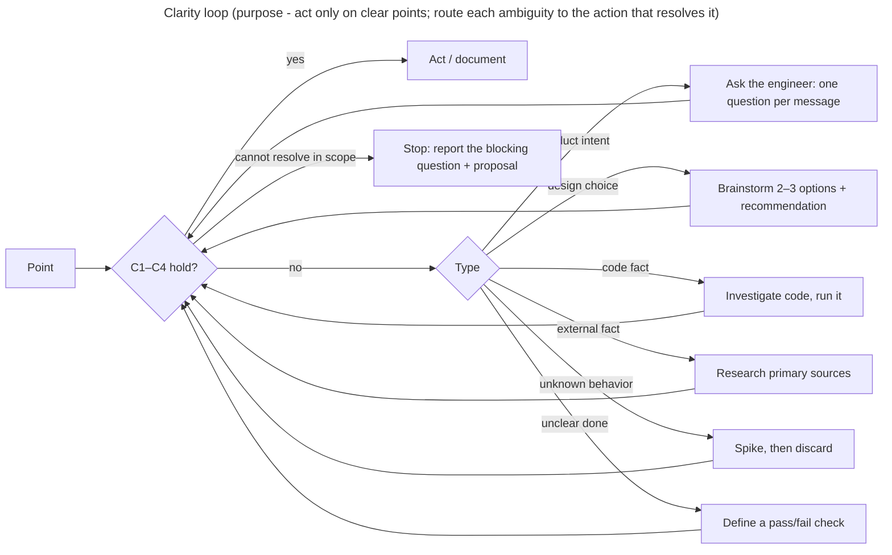

# CLARITY FIRST

Applies to every stage: requirement, design/ADR, plan, implementation, verification.

> [!IMPORTANT]
> **Clear → act. Ambiguous → resolve until clear. Unresolvable in scope → stop and ask.**
> Never guess. Never write down or implement a point that is still ambiguous.
> Only exception: an initiative may record open, ambiguous ideas (§6); it never authorizes work.

## 1. Definition of clear

A statement (requirement, decision, step, criterion) is clear only when all four hold:

| ID | Test | Question |
| --- | --- | --- |
| C1 | One reading | Would two readers build the same thing? |
| C2 | Checkable | Is there a command, test or observation that returns pass/fail? |
| C3 | Grounded | Code facts cite `path:line`; external facts cite a source; product intent cites the engineer's answer |
| C4 | Decided | Choices are made, with who and when |

A detail settled by an existing repo convention or rule is clear if the convention is cited.

## 2. Resolve by type

- Product intent is never decided by the agent.
- When an answer can be read two ways, restate both readings with a recommendation and
  ask before acting (`09-language-and-communication` §3).

## 3. By stage

| Stage | Typical ambiguity | Leave the stage only when |
| --- | --- | --- |
| Requirement | Unbounded scope, adjectives without numbers | Intent restated and confirmed; non-goals listed |
| Design / ADR | Open options, NFR without thresholds | Every decision has a reason and an owner; NFRs have numbers |
| Plan | Vague steps, missing path/command/expected output | Plan ready gate passes; no open question |
| Implementation | Code differs from the plan or the ADR; unplanned case | Stop the task, log a question, return to the stage that owns it |
| Verification | AC readable two ways; no check | Mark `blocked: ambiguous AC`; never `pass` |

## 4. Clarity register

Each ADR, master plan and plan keeps one. During chat-only stages it lives in the chat.

| ID | Ambiguity | Type | Blocks | Resolution · evidence | Status |
| --- | --- | --- | --- | --- | --- |
| Q1 | … | intent · design · code-fact · external · behavior · acceptance | … | … | open · resolved · split-out |

- There is no "assumed" status. An assumption becomes `resolved` only after it is checked.
- `split-out`: too large to resolve inline; it becomes a discovery plan (`NN-spike-…`).
- A stage gate requires zero `open` rows that block that stage.

## 5. Size drives ambiguity

Large work hides ambiguity. Split before planning:

- one plan per component (names from the component cards), one outcome per plan;
- every ambiguous part becomes a discovery plan that runs before the delivery plans that
  depend on it;
- write a detailed plan only for work that is already clear; later plans stay one line in
  the master plan until they are clear.

## 6. Exception: initiatives

An **initiative** (`08-repo-layout-and-naming`) records an idea that is not yet clear: a
product or technology idea the engineer wants to keep and grow. It is the one artifact
where ambiguity may be written down.

| Allowed in an initiative | Still forbidden |
| --- | --- |
| Vague directions, rough hypotheses, inconclusive research | Presenting a guess as a fact: unchecked statements are marked *Unverified* |
| Open questions without a deadline | An unresolved point that is not listed under Open questions |
| Creating the folder before the idea is settled, when the engineer asks to capture it | Implementing, planning or deciding from an initiative |

- An initiative never authorizes work: the gate stays ADR `Accepted` + plan `ready` (`07` §2).
- Crossing into an ADR: every open question that blocks that ADR is resolved in the
  clarity loop (§2) first; the ADR restates what it needs and never cites the initiative
  as a decision.
- The exception covers the initiative folder only; every other stage keeps §1–§5.

## 7. Revision history

- rev 0: (draft) created: definition of clear, resolution by type, per-stage gates,
  clarity register, size rule.
- rev 0 (draft): §6 initiative exception: ambiguity allowed in initiatives, never a gate.
