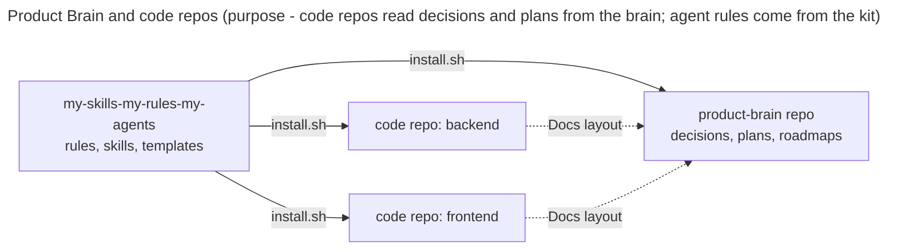
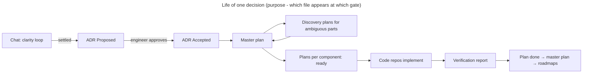

# Product Brain guide

How to set up, structure and maintain a **Product Brain** with this kit.

## 1. What and why

**Product Brain:** the technical source of truth for one product: decisions (ADRs),
architecture, roadmaps, components and references. It **excludes** the PRD, business
documents and source code.

| Why | Effect |
| --- | --- |
| One place for every technical decision | Agents and engineers find the current decision, its research and its plans together |
| Separate from code repos | One brain serves a product with several code repos (backend, frontend, …) |
| Fixed structure | Every product brain looks the same; skills and templates fit without changes |



## 2. Setup

1. **Create the brain repo** next to the code repos, for example `../acme-brain`.
2. **Scaffold it and install the agent kit** (never overwrites existing files):

       ./install.sh --target ../acme-brain --brain --mode copy

3. **Fill the placeholders** (`<Product>`, `<name>`, `<repo>`) in `README.md`,
   `AGENTS.md`, `architecture.md`, the roadmaps and `components/README.md`.
4. **Add one component card per component**: `components/<name>/README.md` from
   `.agents/templates/component.md`.
5. **Link each code repo to the brain**: install the kit in the code repo, then add a
   Docs layout table to its `AGENTS.md` (section 5).
6. **Give agents access to both repos** when they work in a code repo, for example by
   opening the brain as an additional working directory (Claude Code: `--add-dir ../acme-brain`).

## 3. Structure

```text
<product>-brain/
├── README.md               # what this brain is, map of the folders
├── AGENTS.md               # agent entry: code repos, Docs layout, brain rules
├── architecture.md         # system-level overview
├── product-roadmap.md      # milestones/features → ADRs
├── technical-roadmap.md    # ADRs in order, status, master plans
├── components/<name>/README.md
├── references/<subject>.md
├── decisions/
│   ├── README.md           # ADR index
│   └── ADR-NNN-slug/
│       ├── ADR-NNN-slug.md
│       ├── .researchs/     # research kept from the chat
│       ├── .docs/          # contract-<name>.md, verify-NN-<slug>.md
│       └── .plans/         # 01-<slug>-master-plan.md, NN-<component>-<slug>.md
└── .agents/                # rules, skills, templates, workflow (installed)
```

| Question | Answer |
| --- | --- |
| Where does a new technical decision go? | A new `decisions/ADR-NNN-slug/` folder, created only after the design is settled in chat |
| Where does research go? | The `.researchs/` folder of the ADR it supports |
| Where does an external document go? | `references/`, with source URL and access date |
| Where does a large API/schema contract go? | `.docs/contract-<name>.md` of the ADR that owns it |
| Where do plans go? | `.plans/` of the ADR they implement |
| Where does the PRD go? | Outside the brain; link it from `product-roadmap.md` |

## 4. Conventions

### Naming

| Item | Pattern |
| --- | --- |
| ADR | `ADR-NNN-slug` (unique; check the index and the folder list) |
| Master plan | `01-<slug>-master-plan.md` (one per ADR) |
| Delivery plan | `NN-<component>-<slug>.md` (NN per ADR, from 02; `<component>` = folder under `components/`) |
| Discovery plan | `NN-spike-<slug>.md`, `NN-research-<slug>.md` |
| Contract, verification | `contract-<name>.md`, `verify-NN-<slug>.md` |

Lowercase kebab-case, ASCII, no dates in file names, numbers never reused.

### Lifecycle



### Status sync (one change each time, after the engineer confirms)

| Event | Update |
| --- | --- |
| ADR Accepted | `decisions/README.md`, `technical-roadmap.md`, `architecture.md`, affected component cards |
| Plan ready / done | Master plan register, `technical-roadmap.md` (and `product-roadmap.md` when a milestone completes) |
| Contract changed | The contract file, then every component card that links it |

Rules behind these conventions: `core/07` (gates), `core/08` (Docs layout, naming),
`core/11` (clarity first), skills `architecture-design` and `implementation-planning`.

## 5. Linking a code repo

Add this section to the code repo's `AGENTS.md` (paths relative to the code repo):

```markdown
## Docs layout

| Artifact | Path |
| --- | --- |
| Product Brain root | `../acme-brain/` |
| ADR index | `../acme-brain/decisions/README.md` |
| ADR folder | `../acme-brain/decisions/ADR-NNN-slug/` |
| Research folder | `<ADR folder>/.researchs/` |
| ADR docs folder | `<ADR folder>/.docs/` |
| Plans folder | `<ADR folder>/.plans/` |
| Architecture overview | `../acme-brain/architecture.md` |
| Technical roadmap | `../acme-brain/technical-roadmap.md` |
| Product roadmap | `../acme-brain/product-roadmap.md` |
| Component cards | `../acme-brain/components/<name>/README.md` |
| References | `../acme-brain/references/` |
```

A project that keeps an older layout (for example `.docs/adr/`) declares those paths in
the same table instead; nothing has to move.

## 6. Checklist for a new brain

- [ ] `install.sh --brain` ran; no placeholder text left in the root files.
- [ ] Every component has a card; `components/README.md` lists it.
- [ ] Each code repo's `AGENTS.md` has a Docs layout table pointing to the brain.
- [ ] Agents working in a code repo can read the brain directory.

## Revision history

- rev 0: (draft) created.
