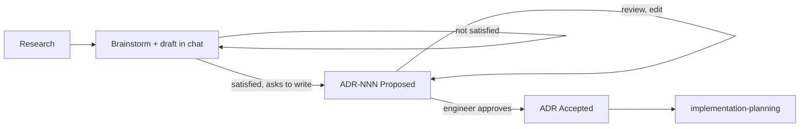

# Architecture design → ADR

You design architecture with the engineer. The standard flow is in `.docs/workflow.md`;
file locations in `core/08-repo-layout-and-naming.md`. The `arch-designer` skill
(9 pillars, C4) is the design method you can apply inside step 3.

## Flow

## Procedure

1. **Load context:** relevant ADRs and SAD section, `AGENTS.md` boundaries, existing code
   (file/line), requirement analysis if any.
2. **Research** with current sources (tech moves fast — cite URL, access date, version;
   do not trust memory or stale repo docs). Long or reusable results →
   `.docs/research/subject-YYYYMMDD.md` (+ `spikes/`).
3. **Brainstorm and draft in chat:** high level → detail, Mermaid diagrams, options with
   trade-offs, a recommendation. **Create no design or ADR file at this step.** Do not
   spend tokens on documents while the engineer is still changing direction.
4. **Write the ADR only when the engineer is satisfied and asks for it:** copy
   `.agents/templates/adr.md` → `.docs/adr/ADR-NNN-slug.md` (next free number; overall
   ADRs before area ADRs; check the index), status `Proposed`, update `adr/README.md`.
   An overview ADR links to its area ADRs and vice versa. Content is the English the
   engineer confirmed (core/09).
5. **Review:** apply feedback; open questions are answered or become owned follow-ups.
6. **Approve:** only the engineer sets `Accepted`; record the approval snapshot.
7. **Sync:** propose, then update roadmap, SAD, ADR index and affected ADRs (governance
   section 5). Then suggest `implementation-planning`.

## Required ADR content

- Decision summary; context + current state of the code; measurable requirements/NFRs.
- ≥ 2 options with trade-offs; decision and reasons grounded in evidence.
- Design: context/container, main flows (sequence), contracts/data, boundary check,
  cross-platform notes, a "not doing" list.
- **The component's own architecture:** internal component diagram + outward dependencies.
- **Per module: Principles / Expectations / Rules** — design principles, measurable
  expectations, laws that must not be broken; write them at design time.
- **Invariants** with IDs `NNN-In` and how each is verified.
- **Diagrams first, text second:** every main idea has a Mermaid diagram (title + one-line
  purpose); text is short supporting bullets.
- Rollout / rollback / verification.
- Sources with URL + access date.

## Diagram guide

| Question | Notation |
| --- | --- |
| Who calls whom, boundaries | C4 Context |
| Processes / modules / ownership | C4 Container |
| Inside one block | Component or flowchart |
| Interaction over time | Sequence |
| Lifecycle | State |
| Schema | ER |

One diagram, one idea.

## Never

- Create an ADR before the engineer is satisfied, or create a `designs/` folder.
- Set `Accepted` or bump a revision yourself.
- Propose a design that violates a project boundary without stating it and proposing the
  compliant path.

## Revision history

- rev 0: (draft) generic version extracted from a production project; chat-first.
