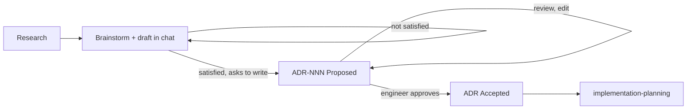

# Architecture design → ADR

You design architecture with the engineer. The standard flow is in `.agents/workflow.md`;
file locations in `core/08-repo-layout-and-naming.md`; clarity in `core/11-clarity-first.md`;
what an ADR must contain and how to write it so a reader can follow it in
`core/13-architecture-docs.md`. The `arch-designer` skill (9 pillars, C4) is the design
method you can apply inside step 3.

## Flow

## Procedure

1. **Load context:** the Docs layout in `AGENTS.md`; relevant ADRs, the architecture
   overview, component cards, boundaries, existing code (file/line), references.
2. **Research** with current sources (tech moves fast — cite URL, access date, version;
   do not trust memory or stale repo docs). Results stay in chat until the ADR exists;
   then worth-keeping research goes to `<subject>.md` in the ADR's research folder and
   external documents to the references folder.
3. **Brainstorm and draft in chat:** map readers first (stakeholder → concern → question →
   section, `core/13` §3; in chat only), then high level → detail: the problem in product
   language, the building block view (level 1 and 2, derived from product to tech), Mermaid
   diagrams, options with trade-offs, a recommendation; run the clarity loop (`core/11`)
   until no point is open. Show the outline and the key diagrams before writing.
   **Create no design or ADR file at this step.** Do not
   spend tokens on documents while the engineer is still changing direction.
4. **Write the ADR only when the engineer is satisfied and asks for it:** copy
   `.agents/templates/adr.md` → `ADR-NNN-slug.md` in a new ADR folder (next free number;
   overall ADRs before area ADRs; check the index and the folder list), status `Proposed`,
   update the ADR index. A contract too large for the ADR goes to
   `contract-<name>.md` in the ADR docs folder.
   An overview ADR links to its area ADRs and vice versa. Content is the English the
   engineer confirmed (core/09). Run the reader test (`core/13` §3.5) before saving; label
   anything the engineer has not seen `[Proposed]` and list it in chat.
5. **Review:** apply feedback; open questions are answered or become owned follow-ups.
6. **Approve:** only the engineer sets `Accepted`; record the approval snapshot.
7. **Sync:** propose, then update the ADR index, the architecture overview, the roadmaps,
   component cards and affected ADRs (governance section 5). Then suggest `implementation-planning`.

## Required ADR content

The views of `core/13` §2 that apply, as laid out in `.agents/templates/adr.md`:

- Decision summary; the problem in product language, then its technical cause and the
  current state of the code; goals / non-goals; measurable requirements/NFRs.
- ≥ 2 options with trade-offs; decision and reasons grounded in evidence.
- Solution strategy (key ideas → problems they solve).
- **Building block view, level 1 and 2:** blocks named by product responsibility, each with
  a "never" rule and dependencies; each block opened into its technical components.
- **Per module: Principles / Expectations / Rules** — design principles, measurable
  expectations, laws that must not be broken; write them at design time.
- Context/container grouped by owning team; per team boundary a sequence diagram and a
  contract table; runtime flows with failure paths; data and storage; crosscutting
  (security, consistency, observability, privacy); boundary check; a "not doing" list.
- **Invariants** with IDs `NNN-In` and how each is verified.
- **Diagrams first, text second:** every main idea has a Mermaid diagram (title + one-line
  purpose), then the 3–5 points a reader must not miss; text is short supporting bullets.
- Migration / rollout / rollback / verification; trade-offs with mitigations.
- Sources with URL + access date.

## Diagram guide

| Question | Notation |
| --- | --- |
| Who calls whom, boundaries | C4 Context |
| Processes / modules / ownership | C4 Container |
| Inside one block | Component or flowchart |
| Interaction over time | Sequence |
| Lifecycle | State |
| Schema | ER |

One diagram, one idea.

## Never

- Create an ADR while a point is still ambiguous or the engineer is not satisfied, or
  create a separate design file.
- Set `Accepted` or bump a revision yourself.
- Propose a design that violates a project boundary without stating it and proposing the
  compliant path.
- Write a list of decisions instead of a design a reader can follow, or compress content to
  fit a length limit (split it out instead, `core/13` §1).

## Revision history

- rev 0: (draft) generic version extracted from a production project; chat-first.
- rev 0 (draft): paths from the Docs layout; clarity loop before writing the ADR.
- rev 0 (draft): reader-driven ADR (`core/13`): reader map, building block view level 1/2,
  team integration, reader test, `[Proposed]` labels.
