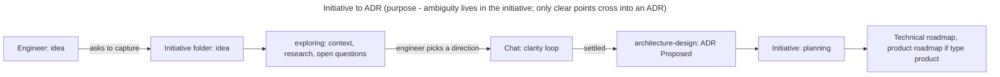

# Initiative shaping

An initiative sits **upstream** of ADRs: it records why an idea might matter, what is
known and what is still open. It is not a decision and not a plan. Read
`core/07-workflow-governance.md`, `core/08-repo-layout-and-naming.md` and
`core/11-clarity-first.md` §6 (the initiative exception) first.

## Use / do not use

- Use: the engineer has an idea to keep, research or put on the initiatives roadmap;
  an initiative changes status or horizon; a direction is ready to become an ADR.
- The engineer already wants a decision on a clear topic → `architecture-design` directly
  (an ADR does not need an initiative).
- A bug → `investigate-bugfix`. Planning work of an Accepted ADR → `implementation-planning`.

## Procedure

1. **Load context:** the Docs layout in `AGENTS.md` (Initiatives index, Initiatives
   folder, Initiatives roadmap). No initiative rows → ask the engineer before creating
   any file (`core/08` §2).
2. **Capture** (only when the engineer asks to keep the idea):
   - Number: next free global `NNN` (3 digits); check the index **and** the folder list.
   - Folder: `NNN-DDMMYYYY-slug/` with today's date; files from
     `.agents/templates/initiative.md` (`README.md`) and `initiative-context.md`
     (`context.md`).
   - Status `idea`, horizon from the engineer (default `someday` only if they say so);
     add the row to the index and to the initiatives roadmap in the same change.
3. **Explore:** research with current sources (URL, access date, version); notes go to
   `.researchs/<subject>.md`. Write what is known and mark what is not: every unresolved
   point goes to **Open questions**; unchecked statements go to `context.md` →
   *Unverified*. Never present a guess as a fact (`core/06`).
4. **Status and horizon changes:** propose `artifact | old → new | reason`, wait for the
   engineer's confirmation, then update the card status log, the index and the
   initiatives roadmap in one change (`core/07` §4).
5. **Hand over to an ADR** when the engineer picks a direction and asks for a decision:
   - Resolve, in chat, every open question that blocks that ADR (`core/11` clarity loop).
     The initiative may keep its other open questions.
   - Run `architecture-design`. The ADR restates what it needs; it never cites the
     initiative as a decision. Set the ADR `Initiative` property to the initiative folder.
6. **Sync on `planning`** (first ADR created; propose, confirm, write in one change):
   card ADR table and status; initiatives index and roadmap; technical roadmap row with
   the Initiative column; product roadmap row too when the type is `product`
   (`core/07` §5).
7. **Follow the work:** when a linked ADR or master plan changes status, update the card
   ADR table; propose `in-progress` when a master plan is `active` and `done` when every
   linked ADR is delivered. Work that needs no technical decision (no ADR) goes from
   `exploring` to `in-progress` and `done` on the engineer's report. Before proposing
   `done`, fill the card's *Outcome* (result against the hypothesis, with evidence).
8. **Close:** `parked` or `dropped` records the reason in the status log and the
   roadmap *Closed* table. The number is never reused.

## Rules

- **Not a gate.** An initiative in any status never authorizes implementation; the gate
  stays ADR `Accepted` + plan `ready` (`core/07` §2).
- **Link, do not nest.** ADRs stay in the ADR folder; an initiative has 0..n ADRs and an
  ADR serves 0 or 1 initiative (its `Initiative` property).
- **One roadmap.** All initiatives share the initiatives roadmap; no per-initiative roadmap.
- **One owner per fact.** A decision lives in its ADR; the initiative links to it and does
  not copy it.
- **English in files** (`core/09`); chat in the engineer's language.

## Checklist before reporting

- [ ] Folder name `NNN-DDMMYYYY-slug`, number unique in the index and the folder list.
- [ ] Card status and horizon equal the index and the initiatives roadmap.
- [ ] Every unresolved point is under Open questions or *Unverified*.
- [ ] Every linked ADR names this initiative; every ADR naming it is in the card.
- [ ] For `planning`+: technical roadmap (and product roadmap for `product`) rows exist.
- [ ] For `done`: the card's *Outcome* is filled with evidence or `not measured`.
