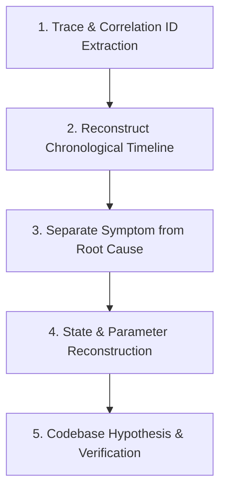

# LOG-DRIVEN INCIDENT & ISSUE INVESTIGATION WORKFLOW

Activate this skill when investigating bugs, analyzing log dumps, tracing distributed exceptions, or debugging regressions.

---

## 1. THE 5-STEP ROOT CAUSE DISCOVERY PROTOCOL

### Step 1: Trace & Correlation ID Extraction
- Find the `trace_id`, `request_id`, or `correlation_id` attached to the reported incident or error snippet.
- If no trace ID exists, isolate the search window using:
  - Timestamp range (Incident time ± 5 minutes).
  - Target service name.
  - Distinct entity identifiers (e.g., `order_id`, `user_id_hash`, or `session_id`).
- Never rely on isolated single-line logs; always inspect surrounding log entries in the same trace.

### Step 2: Reconstruct Chronological Timeline
Order all log statements within that trace by UTC timestamp:
1. **Ingress Call**: When did the request enter? What was the HTTP method and route template?
2. **Intermediate Steps**: Which downstream services, database queries, or cache hits succeeded?
3. **The First Point of Failure (FPOF)**: Identify the earliest warning or error log in the chain.

### Step 3: Separate Symptom from Root Cause
- **The Symptom**: What the user saw (e.g., `500 Internal Server Error`, `UI Spin Forever`, `Blank Screen`).
- **The Cascade**: Secondary failures (e.g., `ConnectionPoolExhausted`, `CircuitBreakerOpen`).
- **The Root Cause**: The fundamental defect (e.g., downstream 3rd party API returned malformed JSON causing JSON parse crash; or database schema missing index causing 30s lock timeout).

### Step 4: State & Parameter Reconstruction
Using the sanitized `context` in the logs:
- Reconstruct the exact inputs that triggered the issue (e.g., `amount: 0`, `currency: "JPY"`, `length: 10000`).
- Check boundary conditions:
  - Is it an edge case (empty string, null, unexpected unicode, zero value)?
  - Is it a concurrency race condition (multiple identical `Idempotency-Key` sent within 2ms)?
  - Is it an infrastructure state change (node restarted, pod OOMKilled, network timeout)?

### Step 5: Codebase Hypothesis & Verification
1. Open the source file and exact line indicated in the stack trace.
2. Formulate a testable hypothesis: *"Under input condition X, function Y assumes Z, which fails with error E."*
3. **Write a Failing Regression Test**:
   - Write a unit or integration test reproducing the exact input condition reconstructed from logs.
   - Run the test: It must fail with the identical error.
4. **Implement the Fix**:
   - Apply defensive coding, validation, or error handling.
   - Run test suite: The test must pass, and no regressions introduced.

---

## 2. HOW AGENT SHOULD INTERACT WITH USER DURING INVESTIGATION

When reporting log analysis findings to the user, always structure the response as follows:

1. **Incident Summary**:
   - Time of occurrence.
   - Affected service and endpoint.
2. **Timeline Analysis**:
   - Step 1 -> Step 2 -> Failure Step.
3. **Root Cause Analysis (RCA)**:
   - Exactly why the failure occurred in code.
4. **Code Evidence**:
   - Link to source code: `[file.ts#L42](file:///path/to/file.ts#L42)`.
5. **Proposed Fix & Prevention**:
   - Code modification.
   - Log improvement (if current logs lacked sufficient context to debug quickly).
   - Automated regression test added.
