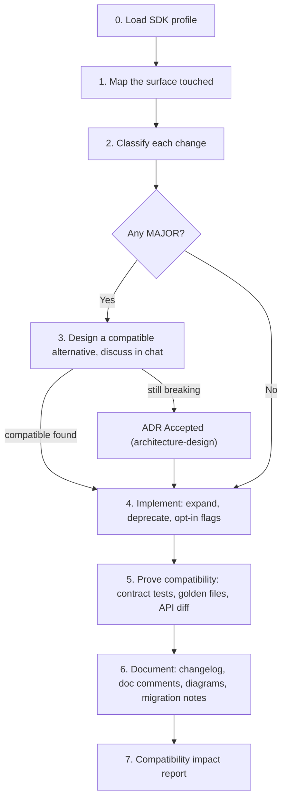

# SDK API evolution

Keep every existing consumer working while the SDK grows. Read
`conventions/sdk-library/conventions.md` (installed as
`.agents/rules/conventions/sdk-library.md`), `core/07-workflow-governance.md` and
`core/10-visual-communication.md` first.

## Use / do not use

- Use: adding, changing, deprecating or removing anything on the public surface
  (convention section 2); reviewing a PR in an SDK repo for compatibility.
- Internal-only refactor with an unchanged public surface: normal workflow, but still run
  the API diff to prove it.
- Cutting a version, writing release notes → `sdk-release`.
- A bug in the SDK → `investigate-bugfix` first; return here if the fix changes the surface.

## Gate (hard)

| Impact | Condition before implementation |
| --- | --- |
| PATCH / MINOR (additive, deprecation) | Normal gate for the work type (`core/07`) |
| MAJOR (breaking) | Compatible alternative presented in chat and rejected by the engineer, **and** an `Accepted` ADR covering the break, migration path and removal timeline |
| Breaking outside MAJOR (security exception, experimental API) | Engineer's explicit approval of the exception, recorded in the ADR or PR |

## Procedure



0. **Load the SDK profile** (convention section 1) from `.docs/sdk/versioning-policy.md`.
   Missing → ask the engineer: audience (`internal`/`public`) and kind (`library`,
   `ui-components`, `api-client`, `cli`). Never guess; record the answer.
1. **Map the surface.** List exactly which surface items (convention section 2, including
   the `ui-components` column when applicable) the change touches. Cite file/line.
2. **Classify** every item with the change → bump tables (sections 3.2 and, for UI, 3.3).
   Check language traps (Rust struct fields/enum variants, Go interface methods, TS union
   widening, Python positional args). The required bump is the maximum.
3. **Avoid the break.** For each MAJOR item, propose the expand → deprecate → migrate →
   contract path (section 4) in chat: options table with consumer impact, effort,
   recommendation. Only if the engineer still chooses to break, route to
   `architecture-design` for the ADR.
4. **Implement compatibly.**
   - New API next to old; options objects instead of new positional params; new behavior
     behind an opt-in flag with the old default.
   - Deprecate with the language mechanism and all four facts: since (`Unreleased`
     placeholder), replacement, removal target, migration link.
   - Mark new symbols with `since: Unreleased` and a stability level if not `stable`.
5. **Prove it.**
   - Contract tests (consumer-style, public API only) pass **unchanged**. Editing them
     means the change is breaking: go back to step 2.
   - Golden/fixture tests for every touched wire format, including old fixtures.
   - Run the ecosystem API diff tool against the last release (section 6) and keep the
     output as evidence. A tool result stricter than your classification wins.
   - Examples and doc snippets build.
   - `ui-components`: stories for new states, visual regression reviewed (accepted diffs
     get a `visual-change` entry and before/after screenshots), axe shows no new violations.
6. **Document in the same change.**
   - `CHANGELOG.md` → `Unreleased` → correct type (`Added`, `Changed`, `Deprecated`,
     `Removed`, `Fixed`, `Security`); entry = **symbol** + verb + consumer effect; prefix
     breaking entries with `**Breaking:**`; add UI labels; link the migration section.
   - Doc comments per section 8.1.
   - Diagram **only if** `core/10` §1 says the change is clearer as a picture; then show
     only the changed region with status classes, prefixes and a legend (`core/10` §3–5).
   - Breaking or deprecation: draft the matching section of
     `.docs/sdk/migrations/vN-to-vM.md` with before/after code.
   - Commit uses Conventional Commits; breaking ⇒ `!` and `BREAKING CHANGE:` footer.
7. **Report** in chat and the PR description (format below).

## Output: compatibility impact report

```markdown
### API compatibility
Profile: internal/library · Required bump: **MINOR** · Action required for consumers: **no**

| | Surface item | Change | Bump | Consumer impact | Mitigation |
| --- | --- | --- | --- | --- | --- |
| + | `Client.fetch(opts)` | optional `signal` | MINOR | none | — |
| ~ | `RetryPolicy.maxAttempts` default | ~~3~~ → <ins>5</ins>, opt-in only | MINOR | none until 3.0.0 | flag `retry.v3Defaults` |

API diff: `<tool> <command>` → exit 0, output: <link/snippet>
Changelog: Unreleased/Added, Unreleased/Deprecated · Migration notes: `.docs/sdk/migrations/v2-to-v3.md#retry-defaults`
```

## Failure / fallback

- No last release to compare against (first release): classify against the documented
  surface and say the diff tool was `N/A: no baseline`.
- No API diff tool in the project: state `not-run` with the reason; propose adding one;
  do not claim compatibility from reading alone for compiled/ABI surfaces.
- Surface ambiguous (undocumented but observable behavior): treat as public, flag it, and
  ask the engineer to decide; record the decision in the versioning policy.

## Revision history

- rev 0: (draft) SDK public API change workflow: profile, classify (incl. UI), avoid breaks, deprecate, prove, document per core/10.
