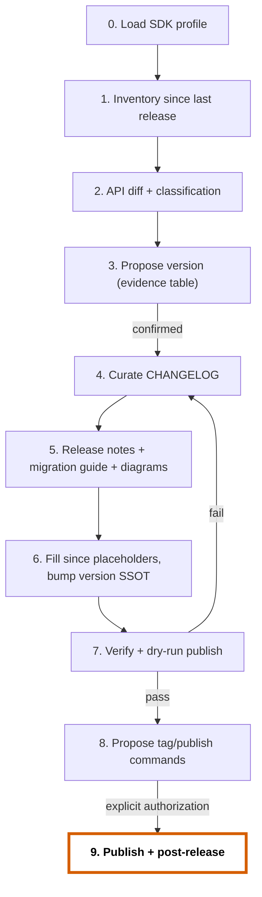

# SDK release

Turn the work since the last release into a correct version number and a complete,
readable record of what changed. Read `conventions/sdk-library/conventions.md` (installed
as `.agents/rules/conventions/sdk-library.md`), `core/07-workflow-governance.md` and
`core/10-visual-communication.md` first.

## Use / do not use

- Use: "release", "bump version", "cut 2.4.0", "write release notes", "write migration
  guide", "prepare a hotfix release", "yank this version".
- Changing the API itself → `sdk-api-evolution`.

## Gate (hard)

| Step | Requires |
| --- | --- |
| Investigate, draft changelog/notes in chat | Nothing |
| Write version, changelog, release notes, migration guide | Engineer confirms the proposed version (step 3) |
| Release a MAJOR | Every breaking change has an `Accepted` ADR and a migration guide section |
| Create/push tag, publish to a registry, create release page | **Explicit authorization for this version in this session.** Preparing is not publishing. |

## Procedure

0. **Load the SDK profile** (convention section 1); missing → ask, never guess. The
   audience sets the deprecation window, required docs and the provenance/SBOM gate; the
   kind adds UI checks and screenshots.
1. **Inventory.** Last release tag (`git describe --tags --abbrev=0`, or the registry),
   commits since (`git log <tag>..HEAD --oneline`), `Unreleased` entries, merged PRs,
   ADRs accepted since the tag. Note any change present in commits but missing from
   `Unreleased`, and the reverse.
2. **Classify.** Run the API diff tool against the last release (convention section 6).
   Classify behavioral changes with section 3.2 and UI changes with section 3.3. Breaking commits (`!`, `BREAKING
   CHANGE:`) must match `**Breaking:**` entries one-to-one.
3. **Propose the version** in chat; do not write files yet:

   | Change | Source (commit/PR/file) | Classification | Evidence |
   | --- | --- | --- | --- |

   `Last: 2.3.1 → Required: MINOR → Proposed: 2.4.0` (pre-release suffix if asked).
   Include: deprecations whose window ends (removable only in a MAJOR), support matrix
   changes, open blockers.
4. **Curate `CHANGELOG.md`** (template `changelog.md`):
   - Move `Unreleased` into `## [X.Y.Z] - YYYY-MM-DD`; add a new empty `Unreleased`.
   - Only the six types, in order: Added, Changed, Deprecated, Removed, Fixed, Security.
   - One entry = one user-visible change: **symbol** + verb + consumer effect, 1–2
     sentences, not the commit subject. Dependency bumps only if user-visible.
   - `**Breaking:**` prefix + link to the migration guide section.
   - Update the compare links at the bottom.
5. **Release notes** for MINOR/MAJOR (template `release-notes.md`) at
   `.docs/sdk/releases/vX.Y.Z.md`, reused as the release page body, in the skeleton order
   of convention section 8.2 (header table → action required → breaking → deprecated →
   new → fixed → links). **Migration guide** for every MAJOR (template
   `migration-guide.md`) at `.docs/sdk/migrations/vN-to-vM.md`: each breaking change
   answers what / who / why / detect / fix (`diff`) / verify.
   Visuals: a Mermaid diagram **only** where `core/10` §1 applies (changed region, status
   classes, legend); before/after screenshots for UI `visual-change` items.
6. **Stamp the version.** Replace `since: Unreleased` / `Unreleased` deprecation
   placeholders with `X.Y.Z`; update the single version source; update the support matrix
   in `versioning-policy.md` if a line enters maintenance or EOL. Grep for leftover
   `Unreleased` placeholders outside `CHANGELOG.md`.
7. **Verify** (record per `core/07` section 6): project check commands; contract tests;
   docs and examples build; changelog links resolve; dry-run publish (`npm pack
   --dry-run`/`npm publish --dry-run`, `cargo publish --dry-run`, `python -m build &&
   twine check dist/*`, `goreleaser release --snapshot`, `dotnet pack`). Any `fail`,
   `blocked` or `not-run` stops the release. Then run the `core/10` §9 self-check on
   every document written (structure, ≤ 3 highlights, legends, concision).
8. **Propose** the exact tag and publish commands, plus the release page body. Wait.
9. **After authorization:** tag (`vX.Y.Z` or the project's monorepo format), publish via
   CI with provenance where supported, create the release page, then propose status/doc
   syncs (roadmap, INDEX) per governance section 4.

## Special cases

| Case | Do |
| --- | --- |
| **Pre-release** | `X.Y.Z-rc.N` (PEP 440: `X.Y.ZrcN`); changelog may group pre-releases under the final version once released |
| **Hotfix on an older major** | Fix on `main` first, cherry-pick to `release/vN.x`, PATCH on that line; changelog entry on both lines |
| **Bad release** | Never overwrite. Yank/deprecate in the registry (`npm deprecate`, `cargo yank`, PyPI yank), mark `[YANKED]` in the changelog heading, publish a fixing PATCH |
| **Security release** | Coordinate disclosure per `SECURITY.md`; `Security` entry with advisory ID; no exploit details before the advisory is public |
| **First release** | Start at `0.1.0` or `1.0.0` per policy; publish `versioning-policy.md` with it |

## Failure / fallback

- Unreleased is empty but commits show user-visible changes → draft entries from
  commits, mark them `(draft)`, ask the engineer to confirm.
- Classification disagrees with the commit types → the stricter wins; flag the commit.
- No registry access or dry-run tool → `blocked`, list what is missing; never claim the
  package is publishable.

## Revision history

- rev 0: (draft) SDK release workflow: profile, evidence-based bump, curated changelog, skeleton-ordered release notes and migration guide, core/10 visuals, authorized publish.
