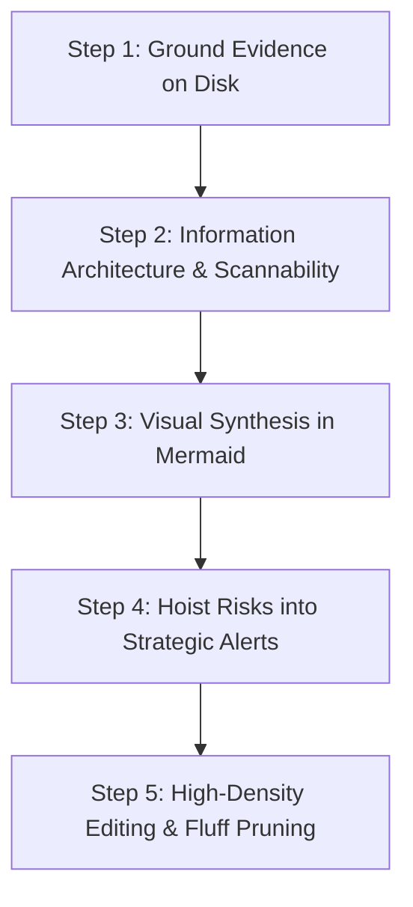

# HIGH-SIGNAL TECHNICAL WRITER & AUDITOR WORKFLOW

Activate this skill when requested to write, refactor, or review any technical documentation, architecture specifications, API contracts, or engineering runbooks.

---

## 1. THE 5-STEP WRITING & VERIFICATION PROTOCOL

### Step 1: Ground Evidence on Disk (Anti-Hallucination)
Before writing a single line of documentation:
1. **Locate Real Source Files**: View and verify the target code files on disk using file viewing/reading tools.
2. **Capture Exact Line Numbers**: Note exact function names, types, and line numbers (`file:///path/to/file#L10-L25`).
3. **Verify Dependencies**: Check `package.json`, `Cargo.toml`, or `go.mod` to ensure cited libraries and versions actually exist.
4. **No Guessed Metrics**: If real benchmark data is unavailable, state `[Target SLA / Pending Load Test]`, never fabricate arbitrary numbers.

### Step 2: Information Architecture & Scannability
Organize the document so that an engineer or architect can scan it in 30 seconds:
- **Top**: 1-2 sentence Problem Statement and Context (No long historical preambles).
- **Core**: Summary Comparison Tables and Key Constraints.
- **Visuals**: Sơ đồ Mermaid (Flowchart, Sequence, Architecture).
- **Deep Dive**: Technical details structured as bulleted lists with bold key anchors.
- **Bottom**: Rollout, Migration Plan, and Verification Checklist.

### Step 3: Visual Synthesis with Mermaid
If explaining:
- **Multi-step processes or business lifecycles** -> Draw a `flowchart TD` or `stateDiagram-v2`.
- **Inter-service API or network interactions** -> Draw a `sequenceDiagram` with both Happy Path and Failure/Timeout paths.
- **Architectural boundaries & cloud components** -> Draw a C4 Container `graph TD` or `graph LR` with clear subgraphs.
- *Mermaid Rule*: Quote node labels with special characters: `node["Label (Details)"]`.
- *Visual language*: Draw only when `core/10-visual-communication` §1 applies; group teams/layers with subgraph frames, mark changes with status classes and prefixes, add a legend, keep ≤ 12 nodes and ≤ 3 highlights.

### Step 4: Hoist Risks into Strategic Alerts
Extract all critical caveats, breaking changes, and high-risk operational steps from paragraphs and hoist them into GitHub-style callouts:
- Use `> [!IMPORTANT]` for invariants and mandatory prerequisites.
- Use `> [!WARNING]` for deprecations, breaking changes, and performance gotchas.
- Use `> [!CAUTION]` for irreversible actions, database migrations, and data loss risks.

### Step 5: High-Density Editing (Fluff Pruning)
Review the draft and apply the **40% Fluff Cut**:
- Cut vague adjectives: *"extremely robust"*, *"seamlessly integrated"*, *"cutting-edge"*, *"very easy"*.
- Cut wordy passive voice: *"It should be noted that the system is configured by us to..."* -> *"Configure the system to..."*.
- Convert multi-sentence descriptions of alternatives into a **Markdown Comparison Table**.
- Ensure no paragraph exceeds 3 sentences.

---

## 2. OUTPUT VERIFICATION CHECKLIST FOR AGENTS

Before handing the document to the user:
- [ ] Are all code citations backed by real file paths?
- [ ] Are complex flows visualized with Mermaid diagrams?
- [ ] Are alternative options organized in comparison tables?
- [ ] Are warnings and cautions highlighted in callouts?
- [ ] Can the reader grasp the core intent in 30 seconds?
- [ ] Does the `core/10-visual-communication` §9 self-check pass?
