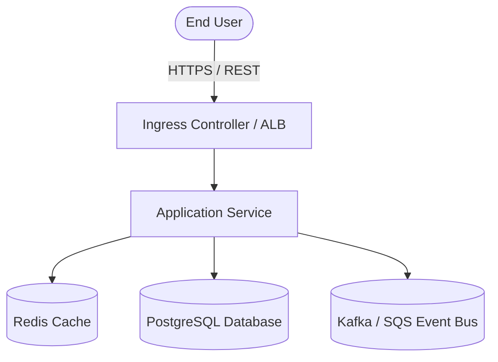
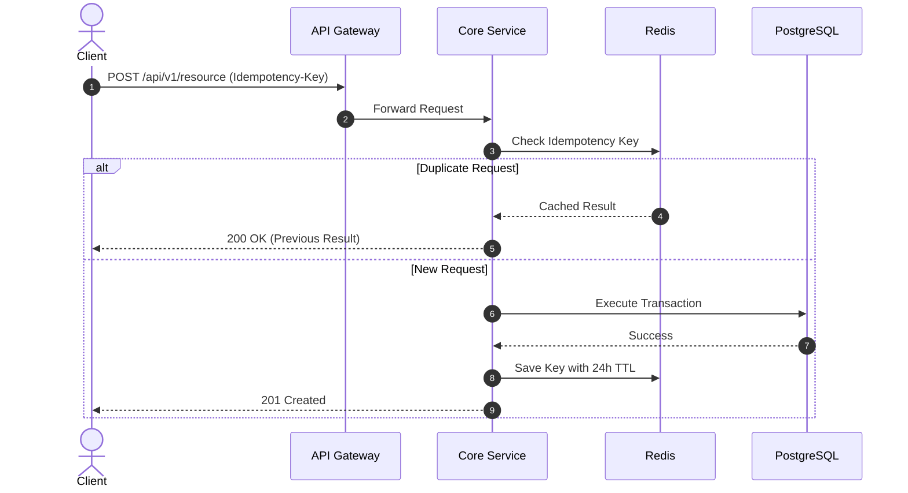
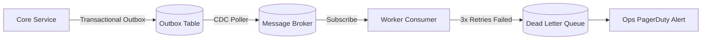
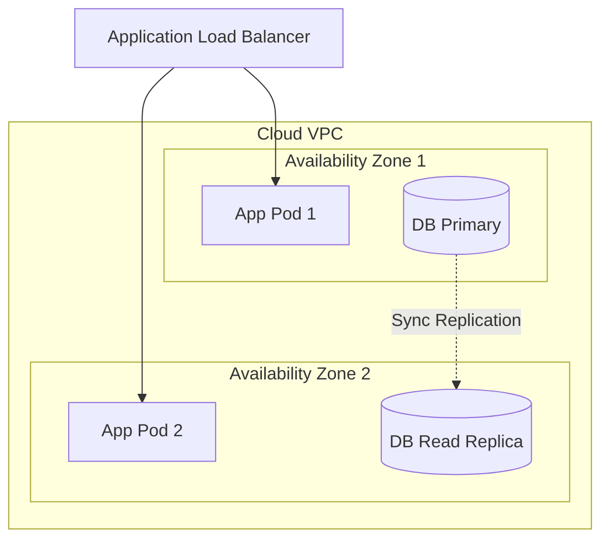

# ARCHITECTURE DESIGN SPECIFICATION: [Feature / System Name]

- **Author / Designer:** [Name / Agent]
- **Status:** [Draft | Under Review | Approved | Superseded]
- **Target Release:** [vX.Y.Z]
- **ADR Reference:** [ADR-000X](docs/architecture/adr/ADR-000X.md)

---

## 1. BUSINESS CONTEXT & REQUIREMENTS
- **Executive Summary:** [1-2 sentences summarizing the technical problem and proposed solution]
- **Functional Requirements:**
  - `[FR-01]`: ...
  - `[FR-02]`: ...
- **Non-Functional Requirements & SLAs:**
  - Throughput: [e.g., Target 2,500 RPS peak]
  - Latency: [e.g., p95 < 120ms, p99 < 300ms]
  - Availability SLA: [e.g., 99.95% uptime]

---

## 2. 9 ARCHITECTURAL PILLARS SCORECARD
*Every design must explicitly score compliance against the 9 Pillars.*

| Pillar | Compliance Status | Technical Solution & Rationale |
|---|---|---|
| **1. High Availability** | [Compliant / N/A] | [e.g., Multi-AZ deployment across us-east-1a and 1b; automated health checks] |
| **2. Resilience** | [Compliant / N/A] | [e.g., Circuit breaker with 50% trip threshold; exponential backoff retry; DLQ for failed events] |
| **3. Scalability** | [Compliant / N/A] | [e.g., Stateless microservices; Redis Cache-Aside for read layer; HPA scaling on 70% CPU] |
| **4. Consistency** | [Compliant / N/A] | [e.g., Transactional Outbox pattern with Debezium CDC; Idempotency-Key on mutation APIs] |
| **5. Security** | [Compliant / N/A] | [e.g., Zero Trust; JWT Bearer with RS256; TLS 1.3; least privilege IAM roles; AES-256 at rest] |
| **6. Privacy** | [Compliant / N/A] | [e.g., PII fields tokenized before storage; automated data masking in application logs] |
| **7. Observability** | [Compliant / N/A] | [e.g., OpenTelemetry tracing injected; structured JSON logs with trace_id; Prometheus metrics] |
| **8. Extensibility** | [Compliant / N/A] | [e.g., Webhook dispatching architecture for third-party consumers; Feature Flag rollout] |
| **9. Pragmatism & Cost** | [Compliant / N/A] | [e.g., Aurora Serverless v2 to scale compute down during off-peak hours] |

---

## 3. ARCHITECTURE DIAGRAMS (MERMAID)

### 3.1. Static View (C4 Context & Containers)

### 3.2. Dynamic View (Sequence Diagram with Failure Paths)

### 3.3. Integration View (Async Events & DLQ)

### 3.4. Deployment View (Network & Redundancy)

---

## 4. API & DATA CONTRACT SPECIFICATION
- **Endpoint:** `POST /api/v1/orders`
- **Request Headers:**
  - `Idempotency-Key`: `string (uuid)` (Required)
  - `Authorization`: `Bearer <jwt>` (Required)
- **Response Codes:**
  - `201 Created`: Successfully processed.
  - `400 Bad Request`: Schema validation error.
  - `409 Conflict`: Concurrent mutation with identical key.
  - `503 Service Unavailable`: Downstream dependency circuit breaker open.

---

## 5. MIGRATION & ROLLOUT PLAN
- **Phase 1 (Expand)**: Deploy database schema migrations concurrently with zero table locks.
- **Phase 2 (Canary)**: Deploy new application code behind Feature Flag to 5% internal traffic.
- **Phase 3 (Cutover)**: Scale to 100% traffic upon zero error alerts for 24 hours.
- **Phase 4 (Contract)**: Drop legacy unused columns/endpoints in subsequent release.
