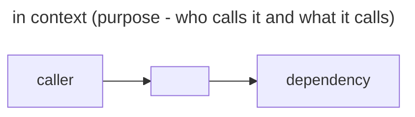

# <component>

<!--
File: the component card path in the Docs layout (Product Brain: components/<name>/README.md).
One card per component of a multi-component product.
The folder name is the component name used in plan file names. Keep it short; link to
ADRs and contracts instead of copying them. Delete comments before use.
-->

<1–2 sentences: what it does for the product.>

| Owns | Does not own |
| --- | --- |
| … | … |

| Interface | Direction | Defined in |
| --- | --- | --- |
| … | provides · consumes | ADR-NNN §x or its `contract-<name>.md` |

Commands (cwd: `<dir>`): build `…` · test `…` · run `…`

Local conventions: … (only what differs from `.agents/rules/`)

ADRs: ADR-NNN (…), ADR-NNN (…)
