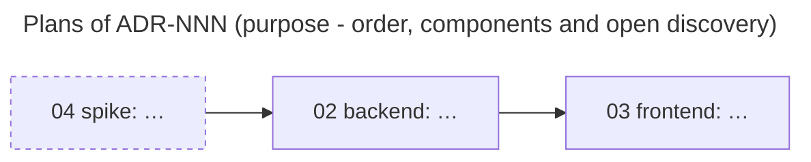

# Master plan — <ADR title>

<!--
File: 01-<slug>-master-plan.md in the ADR's plans folder (Docs layout; always number 01).
Links below assume the Product Brain layout; adjust them to the project's Docs layout.
Controls every plan of one ADR: order, components, contracts, clarity, status.
Holds no task detail; tasks live only in the plans. Write in English, short and plain
(core/06 §7). Delete every comment and unused row before use.
-->

| Property | Value |
| --- | --- |
| ADR | [ADR-NNN-slug](../ADR-NNN-slug.md) · rev N · `<commit or content hash>` |
| Status | draft · active · paused · done · abandoned |
| Revision | rev 0 |
| Owner | <engineer> · Planner: <model/person> |
| WIP | at most <n> plans `in-progress` at once |

## 1. Outcome and intent

<2–3 sentences: what works when every plan here is done.>

Demo: `cwd: <dir>` `$ <command>` → `<expected>`

Intent brief (core/11 §3.1). Length follows scope; every field is filled.

| Field | Content |
| --- | --- |
| Goal and users | … |
| Work type | port · migration · refactor · feature · bulk change |
| Agreed approach | <the approach settled with the engineer; ADR §4> |
| Rejected approaches | <option → reason; ADR §3>. No plan may bring one back. |
| Done measure | <commands, tests or observations that prove the outcome> |
| Tooling needed | <tool → purpose → ID it serves → size estimate → local (`.agents/tools/`, `.agents/scripts/`, never committed) or shared (project folder)>, or `none` |

Confirmed by <engineer> · <when> · <reference>.

## 2. Scope

| ID | Item | In / Out | Note |
| --- | --- | --- | --- |
| S-01 | … | in | |
| S-02 | <tempting adjacent work> | out | <reason> |

Inventory (port, migration and bulk change only; delete otherwise). One row per unit to
carry over: endpoint, service, worker, topic, table.

| ID | Unit | Source (`path:symbol`) | Plan | Parity check | Status |
| --- | --- | --- | --- | --- | --- |
| INV-001 | `POST /orders` | `…` | 02 | `<test>`: same request → same response, DB rows, messages | todo |
| INV-002 | `<worker>` | `…` | — | — | dropped (S-02) |

## 3. Plan map

Dashed border = discovery plan (removes an ambiguity, ships no product code).

## 4. Plan register

| No | File | Type | Component | Outcome (one line) | Depends | Clarity | Status |
| --- | --- | --- | --- | --- | --- | --- | --- |
| 02 | `02-<component>-<slug>.md` | delivery | [<name>](<component card link>) | … | 04 | clear | ready |
| 03 | — | delivery | <name> | … | 02 | ambiguous (Q2) | outline |
| 04 | `04-spike-<slug>.md` | discovery | — | Answers Q1 | — | n/a | in-progress |

- A delivery plan file is created only when `Clarity = clear` and every dependency is `done`.
- An `outline` row holds one line only.
- A plan too large for one executor session may split its tasks into phase files next to it
  (`NN-<component>-<slug>/phase-M-<slug>.md`), each holding only intent, tasks, checks and
  its log; shared executor rules and procedures stay once in the plan.
- Split rule: one plan per component and per outcome; ambiguous parts become discovery plans.
- Pilot: the first delivery plan carries one unit from start to passing check (code and
  its done measure). Later plans are written in detail after the pilot checkpoint.
- Checkpoint: after the pilot and after each plan `done`, the engineer compares the result
  with §1 and the signals of governance §7 before the next plan starts.

## 5. Coverage

| Item | Covered by | Note |
| --- | --- | --- |
| D-01 … | 02 | |
| I-03 … | 02, 03 | |
| S-01 … | 02 | |

Every in-scope decision (D), invariant (I) and scope row (S) has ≥ 1 plan. Inventory rows
are covered in the §2 inventory table.

## 6. Contracts between components

Defined in the ADR or in `contract-<name>.md` in the ADR docs folder. This table only points to them.

| Contract | Defined in | Producer | Consumers |
| --- | --- | --- | --- |
| C1 … | ADR §x.y | 02 | 03 |

## 7. Clarity register

| ID | Ambiguity | Type | Blocks | Resolved by | Evidence | Status |
| --- | --- | --- | --- | --- | --- | --- |
| Q1 | … | intent · design · code-fact · external · behavior · acceptance | 02 | 04 | … | open |

## 8. Control rules

- A plan cannot widen scope, add plans, change contracts or make ADR decisions. It writes
  a proposal in its decision log; the owner decides here.
- Re-plan when a discovery result changes an ADR item or contract, a new ambiguity blocks
  more than one plan, or a plan no longer fits one component and one outcome.
- A status change updates the plan, §4 here and the technical roadmap in one change
  (propose → confirm → write).
- A content change follows governance §5.1: an edit here lists the changed IDs in the
  revision history and updates every plan that cites them in the same change; an edit to
  a plan's goal, scope, interfaces or AC updates §2, §4, §5 and §6 here in the same change.
- Tooling (runner, harness, generator, script, new dependency) is built only as a task of
  a plan and is listed in §1 "Tooling needed" (governance §7).

## 9. Log

| Date | Change | Reason | Confirmed by |
| --- | --- | --- | --- |

## 10. Approval

- [ ] §1 outcome and demo are clear (core/11 C1–C4); the intent brief is confirmed by the engineer.
- [ ] §5 covers every in-scope ADR item and scope row; every inventory row has a plan or is `dropped` with a reason.
- [ ] Every open question in §7 maps to a discovery plan or an engineer question.
- [ ] The first plans to run are `clear`; the first delivery plan is the pilot.
- [ ] Consistency check (governance §5.1) reports no finding.
- [ ] Removal check (`implementation-planning`): a fresh agent reading this master plan finds no
      plan or scope row that can be removed while §1 is still met.
- [ ] Over-engineering review (governance §7) done by <reviewer>; every row decided by the engineer.

Approved by · when · reference · revision + hash.

## Revision history

<!-- Each entry names the IDs whose meaning changed: "rev 2: S-03 narrowed, C1 field renamed · IDs: S-03, C1". -->

- rev 0: created.
