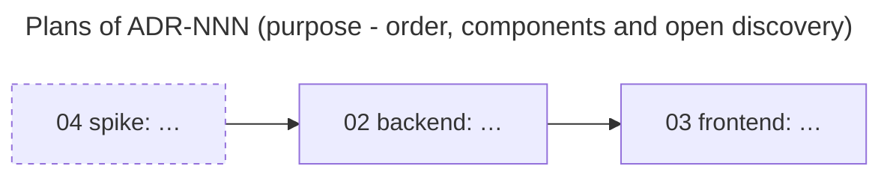

# Master plan — <ADR title>

<!--
File: 01-<slug>-master-plan.md in the ADR's plans folder (Docs layout; always number 01).
Links below assume the Product Brain layout; adjust them to the project's Docs layout.
Controls every plan of one ADR: order, components, contracts, clarity, status.
Holds no task detail; tasks live only in the plans. Write in English, short and plain
(core/06 §7). Delete every comment and unused row before use.
-->

| Property | Value |
| --- | --- |
| ADR | [ADR-NNN-slug](../ADR-NNN-slug.md) · rev N · `<commit or content hash>` |
| Status | draft · active · paused · done · abandoned |
| Revision | rev 0 |
| Owner | <engineer> · Planner: <model/person> |
| WIP | at most <n> plans `in-progress` at once |

## 1. Outcome

<2–3 sentences: what works when every plan here is done.>

Demo: `cwd: <dir>` `$ <command>` → `<expected>`

## 2. Scope

| In scope | Out of scope |
| --- | --- |
| … | … |

## 3. Plan map

Dashed border = discovery plan (removes an ambiguity, ships no product code).

## 4. Plan register

| No | File | Type | Component | Outcome (one line) | Depends | Clarity | Status |
| --- | --- | --- | --- | --- | --- | --- | --- |
| 02 | `02-<component>-<slug>.md` | delivery | [<name>](<component card link>) | … | 04 | clear | ready |
| 03 | — | delivery | <name> | … | 02 | ambiguous (Q2) | outline |
| 04 | `04-spike-<slug>.md` | discovery | — | Answers Q1 | — | n/a | in-progress |

- A delivery plan file is created only when `Clarity = clear` and every dependency is `done`.
- An `outline` row holds one line only.
- Split rule: one plan per component and per outcome; ambiguous parts become discovery plans.

## 5. ADR coverage

| ADR item | Covered by | Note |
| --- | --- | --- |
| D-01 … | 02 | |
| I-03 … | 02, 03 | |

Every in-scope decision (D) and invariant (I) of the ADR has ≥ 1 plan.

## 6. Contracts between components

Defined in the ADR or in `contract-<name>.md` in the ADR docs folder. This table only points to them.

| Contract | Defined in | Producer | Consumers |
| --- | --- | --- | --- |
| C1 … | ADR §x.y | 02 | 03 |

## 7. Clarity register

| ID | Ambiguity | Type | Blocks | Resolved by | Evidence | Status |
| --- | --- | --- | --- | --- | --- | --- |
| Q1 | … | intent · design · code-fact · external · behavior · acceptance | 02 | 04 | … | open |

## 8. Control rules

- A plan cannot widen scope, add plans, change contracts or make ADR decisions. It writes
  a proposal in its decision log; the owner decides here.
- Re-plan when a discovery result changes an ADR item or contract, a new ambiguity blocks
  more than one plan, or a plan no longer fits one component and one outcome.
- A status change updates the plan, §4 here and the technical roadmap in one change
  (propose → confirm → write).

## 9. Log

| Date | Change | Reason | Confirmed by |
| --- | --- | --- | --- |

## 10. Approval

- [ ] §1 outcome and demo are clear (core/11 C1–C4).
- [ ] §5 covers every in-scope ADR item.
- [ ] Every open question in §7 maps to a discovery plan or an engineer question.
- [ ] The first plans to run are `clear`.

Approved by · when · reference · revision + hash.

## Revision history

- rev 0: created.
