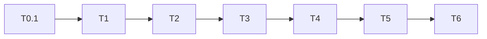

# PLAN-NNN-slug

| Property | Value |
| --- | --- |
| ID | PLAN-NNN-slug |
| Created | YYYY-MM-DD |
| Revision | rev 0 |
| Status | draft |
| ADR | ADR-NNN-slug (Accepted) |
| Requirement | REQ-YYYYMMDD-slug (optional) |

## Goal

One paragraph. Link the ADR.

## Applicable invariants (must not be violated)

List the invariant IDs (`NNN-In`) from the related ADRs that this plan touches, plus
project-wide rules from `AGENTS.md` if needed. If finishing a task would violate one,
**STOP and ask the engineer**.

| ID | How it applies in this plan | Checked by (command / test) |
| --- | --- | --- |
| NNN-In | … | … |

## Executor brief (for a smaller model that has never seen the repo)

Reading only this plan plus the files it points to must be enough to do the work.

- **Context:** the relevant current system (full file paths, key functions/types), with
  terms explained in plain words.
- **Fixed interfaces:** names of types, functions and fields; the executor must not change them.
- **Per task:** files that may be edited; command + working directory; what correct output
  looks like; common wrong outputs and how to recognize them.
- **Stop and ask when:** a test fails differently than expected; a file outside the list
  must change; a schema/boundary/dependency change is needed; the plan contradicts the
  code; an invariant would be violated.
- **Do not invent:** where the plan lacks information write `[NEEDS CLARIFICATION: …]` in
  the log and stop that task.
- **Safe re-run:** which steps are idempotent; how to undo if something breaks.

## Execution log (update after each task)

- **Progress:** `- [x] T1 (YYYY-MM-DD HH:MM) — short result + command run`
- **Surprises & discoveries:** anything unlike the plan, with evidence (output).
- **Decision log:** decisions made during execution, reason, who decided.

## TDD first

Write the test before the code for every behavior change (including schema/contract):

1. Write a test describing the expected behavior → it FAILS (red).
2. Implement the minimum → it PASSES (green).
3. Refactor while keeping it green.

A reproducing test is a living acceptance criterion; do not delete it once the code works.

## Acceptance criteria

Measurable, all must PASS. Use EARS: `WHEN <condition> THEN <component> SHALL <measurable
behavior>` (or `<component> SHALL ALWAYS …`). Each AC points to ≥ 1 test or command.

- [ ] AC1: …
- [ ] AC2: project checks pass with zero warnings (`<check command>`)
- [ ] AC3: architecture/boundary checks have no violations (`<arch command>`)
- [ ] AC4: end-to-end journey passes on every required platform
- [ ] AC5: performance within budget
- [ ] AC6: ADR is `Accepted`, docs updated

## Task breakdown

Drop phases that do not apply. Every task from Phase 1 on states an **Expected outcome**:
the concrete state when done (which file/function exists, what a command prints).

### Phase 0 — Test first (TDD red)

When executing a task: write the behavior test, run it, and record the RED with the
correct cause. During planning only describe the test; do not create or run it, and do
not claim it failed.

| ID | Title | Depends | Touches | Test | Exit criteria |
| --- | --- | --- | --- | --- | --- |
| T0.1 | Write test for feature/bug | none | `tests/...` | test name | test FAILS (red) |

### Phase 1 — Schema / contract

| ID | Title | Depends | Touches | Boundary | Verification | Exit criteria | Risk |
| --- | --- | --- | --- | --- | --- | --- | --- |
| T1 | … | T0.1 | `<schema path>` | no | `<schema check>` | schema valid | low |

### Phase 2 — Core logic (TDD green)

| ID | Title | Depends | Touches | Boundary | Verification | Exit criteria | Risk |
| --- | --- | --- | --- | --- | --- | --- | --- |
| T2 | … | T1 | `<module path>` | no | `<unit test command>` | T0.1 test PASSES | medium |

### Phase 3 — Integration

| ID | Title | Depends | Touches | Boundary | Verification | Exit criteria | Risk |
| --- | --- | --- | --- | --- | --- | --- | --- |
| T3 | … | T2 | `<adapter path>` | no | `<arch check>` | 0 violations | medium |

### Phase 4 — UI (if any)

| ID | Title | Depends | Touches | Boundary | Verification | Exit criteria | Risk |
| --- | --- | --- | --- | --- | --- | --- | --- |
| T4 | … | T3 | `<ui path>` | no | `<e2e command>` | journey passes | low |

### Phase 5 — Regression and coverage

| ID | Title | Depends | Touches | Boundary | Verification | Exit criteria | Risk |
| --- | --- | --- | --- | --- | --- | --- | --- |
| T5 | … | T4 | `tests/...` | no | `<test command>` | coverage as required | low |

### Phase 6 — Docs

| ID | Title | Depends | Touches | Boundary | Verification | Exit criteria | Risk |
| --- | --- | --- | --- | --- | --- | --- | --- |
| T6 | … | T5 | `.docs/...` | no | review | updated | low |

## Dependency graph

## Ready gate and traceability

- [ ] The topic's ADR is Accepted (or N/A with a reason).
- [ ] Approval matches the snapshot; REQ/AC/NFR/journey have not drifted.
- [ ] Tasks have depends, RED/GREEN tests, exit criteria, risk and rollback.
- [ ] No blockers; verification commands, platforms and prerequisites are clear.

| AC (ADR / REQ) | NFR / Journey (ADR) | Task | Test / command | Evidence on execution |
| --- | --- | --- | --- | --- |
| fill | fill | fill | fill | not-run |

Status `ready` only when this checklist holds; `done` needs the execution results below.

## Verification plan

| Layer | What it checks | Command (from repo root) | Correct output | Evidence goes to |
| --- | --- | --- | --- | --- |
| Unit | Logic of each function per AC | `<unit command>` | all pass, 0 failed | Execution log |
| Property _(when the AC is an invariant)_ | Law holds for any input | property-test command | pass | Execution log |
| Integration | Flow across modules/processes | `<integration command>` | pass, stable across n runs | Execution log |
| Architecture | Boundaries + invariants | `<arch check>` | OK | Execution log |
| Contract | Schema + fixtures | `<schema check>` | valid | Execution log |
| Invariants | Each ID in the invariants table | command/test from that table | as in table | Execution log |
| Review | Compare against ADR + invariants | skill `implementation-verification` | VER `passed` | `.docs/verifications/VER-*` |

## Verification checklist

Run before claiming "plan done". Each applicable item needs pass + evidence; N/A needs a
reason; blocked/not-run items are never ticked.

### Code quality
- [ ] format check, lint, typecheck/compile all pass with zero warnings (use the project's commands)

### Test
- [ ] full test suite passes (all T0.1 tests PASS)
- [ ] end-to-end tests pass (if UI touched)
- [ ] TDD: test written first, FAILED before implementation, PASSED after

### Architecture & schema
- [ ] boundary check has 0 violations
- [ ] schema/contract check valid; generated code regenerated (if a schema changed)

### Non-functional (per NFRs in the ADR)
- [ ] Security (secrets, permissions, egress)
- [ ] Performance (benchmark within budget)
- [ ] Scalability (load test if an NFR requires it)
- [ ] Consistency (idempotency, conflict resolution if applicable)
- [ ] HA / reliability (crash recovery, no data loss if applicable)

### Cross-platform
- [ ] Every required platform/architecture passes (or CI runner evidence)

### Docs
- [ ] ADR status `Accepted`
- [ ] Developer guide updated (if needed); changelog entry
- [ ] Revision unchanged; bump only when the engineer confirms

## Risk register

| Risk | Level | Mitigation | Owner |
| --- | --- | --- | --- |
| … | high/medium/low | … | … |

## Exit criteria (plan done)

- Every task T0..T6 is `done`; every AC is checked.
- Every required check passes with evidence; N/A has a reason.
- Project check + test commands pass; boundary and schema checks pass.
- ADR is `Accepted`; docs updated.
- Revision bumps only on the engineer's confirmation and is not a done condition.

## Approval and evidence snapshot

- Approval: none yet; fill only when the engineer confirms this exact content.
- Who / when / message reference: none yet.
- Applies to: artifact + revision + commit or snapshot hash.
- Unapproved changes: `(draft): …`; downstream needs re-review if scope/AC/NFR changes.

## Revision history

- rev 0: created (YYYY-MM-DD)
