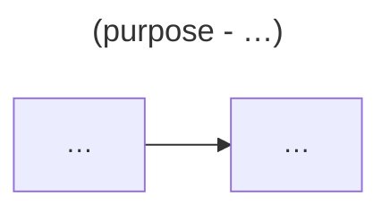
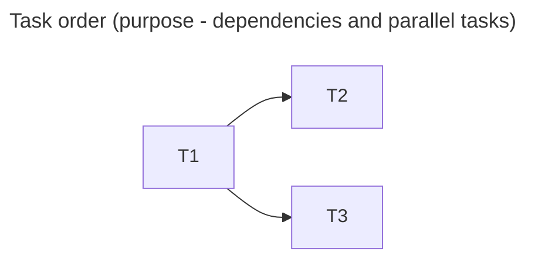

# NN — <imperative title>

<!--
File: NN-<component>-<slug>.md in the ADR's plans folder (Docs layout; discovery: NN-spike-<slug>.md).
Links below assume the Product Brain layout; adjust them to the project's Docs layout.
One component, one outcome. Follows the Accepted ADR; makes no new decision.
Written for an executor that has never seen the repo. Short and plain (core/06 §7);
Mermaid for flows and order (core/10). Delete every comment and unused row before use.
-->

| Property | Value |
| --- | --- |
| ADR | [ADR-NNN-slug](../ADR-NNN-slug.md) · rev N · `<hash>` · sections §… |
| Master plan | [01-<slug>-master-plan](01-<slug>-master-plan.md) |
| Component | [<name>](<component card link>) |
| Type | delivery · discovery |
| Status | draft · ready · in-progress · blocked · done · abandoned |
| Revision | rev 0 |
| Executor | <model tier / person> · Autonomy: attended · unattended |

> **Executor rules**
> 1. Read §1–§6, then one task at a time, in the order of §8.
> 2. Edit only the files listed in the task. Never change §1–§6.
> 3. After each step, run `Run` and compare with `Expect`. Paste the decisive output line into §10.
> 4. **Stop** when the output is not `Expect`, a file outside the list must change, the code
>    contradicts the plan or the ADR, or anything is unclear. Add a question to §6 and report.
>    Never guess. Outside these cases, continue without asking.
> 5. Never delete or weaken a test or an AC. End each session clean and update Handoff.

## 1. Goal

<One sentence: the observable result.>

Demo: `cwd: <dir>` `$ <command>` → `<expected>`

## 2. Scope

- **In:** …
- **Out:** … (name the tempting adjacent work)
- **Do not touch:** `<paths>`
- **Keep working** (existing behavior → guard): … → `<test>`

## 3. Context

<2–3 sentences: where this component sits and what changes.>

| Read first (path : symbol) | Why |
| --- | --- |
| Component card of `<name>` | Role, interfaces, commands |
| `…` | … |

Example to follow: `path : symbol`. Glossary: *term*: meaning.

## 4. From the ADR (fixed)

| ADR item | What it means for this plan |
| --- | --- |
| D-01 | … |
| I-03 | … — checked by `<command>` |

Interfaces (exact):

    Consumes: <signature / schema> (from plan NN, existing code or the contract file)
    Produces: <signature / schema> (used by plan NN)

## 5. Acceptance

| ID | WHEN … THEN … SHALL … | Check |
| --- | --- | --- |
| AC-1 | … | `<command> <test>` |
| AC-G | Project checks pass, 0 warnings; boundary check 0 violations | `<check>` · `<arch>` |

Review focus (the most likely missed failures, most likely first):

1. <input/failure class> → expected behavior → covered by T…

## 6. Clarity register

| ID | Question | Type | Blocks | Resolution · evidence | Status |
| --- | --- | --- | --- | --- | --- |

`ready` requires no `open` row (core/11).

## 7. Tasks

### T1 — <imperative title>

- **ADR:** D-01, I-03 · **AC:** AC-1 · **Depends:** — · **Freedom:** low · medium · high
- **Files:** edit `path` (`symbol`) · create `path` · test `path`
- **File responsibility:** one line per created or edited file; a new concept gets a new file (`core/12-modularity`).
- **Consumes / Produces:** see §4 (or the exact signature)
- **Steps:**
  - [ ] Write test `<name>` asserting `<exact values>`.
        Run `<cmd>` → fails with `<message>` because the behavior is missing.
  - [ ] Implement `<signature>` in `path`. Approach: <one line>.
  - [ ] Run `<cmd>` → `<expected pass line>`.
- **Wrong if:** `<output>` → means … → stop.
- **Undo:** `<command>`
- **Done when:** <state on disk> and the check above passes.

<!-- Task boundary: a reviewer could accept this task and reject the next one.
     Freedom low = exact commands, no variation; high = goal + constraints only. -->

## 8. Order

Tasks that share no file and have no dependency on each other may run in parallel.

## 9. Risks

| Risk | Signal | Mitigation / rollback |
| --- | --- | --- |

## 10. Execution log

- **Baseline** (before T1): `$ <check>` → `<result>`
- **Progress:** `- [x] T1 (YYYY-MM-DD HH:MM) — <result> · <cmd> → <line>`
- **Surprises:** … with evidence
- **Decisions / proposals:** … (proposals that touch §1–§6 wait for the planner)
- **Handoff:** last done · next step · blockers · workspace clean?

## 11. Outcome

Demo result · AC result (link the verification report) · what the plan missed →
feedback for this template.

## 12. Ready gate (planner self-review)

- [ ] Every ADR item in §4 maps to a task; every task cites an ADR item and an AC.
- [ ] Each step allows exactly one reasonable action; no banned vague word (core/06 §7).
- [ ] Names and signatures match across tasks, §4 and the ADR.
- [ ] Every Review focus item has a test in some task.
- [ ] Each new concept has its own file; no task adds a second responsibility to an existing file or grows a file over its limit.
- [ ] Every path exists (or is marked create); every command has a cwd and an expected output.
- [ ] §6 has no open question; the plan covers one component and one outcome.
- [ ] Builder check: a fresh subagent reading only this file restates T1 correctly, and
      its questions (if any) are answered in one round.

Approved by · when · reference · revision + hash.

## Revision history

- rev 0: created.
