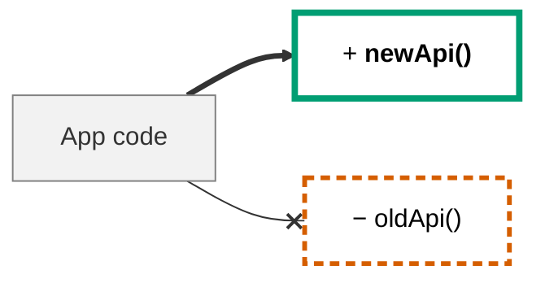

# <SDK name> vX.Y.Z

<!--
Release notes for a MINOR or MAJOR release (PATCH: changelog entry only).
Location: .docs/sdk/releases/vX.Y.Z.md; the same body is the release page.
Order is fixed (conventions/sdk-library §8.2): most important first. Delete empty sections.
Emphasis and diagrams: core/10-visual-communication. Entries: **symbol** + verb + effect, 1–2 sentences.
Delete this comment.
-->

| Version | Date | Action required | Effort | Breaking | Labels |
| --- | --- | --- | --- | --- | --- |
| X.Y.Z (MINOR/MAJOR) | YYYY-MM-DD | **Yes** / No | None / Low / Medium / High | N | `visual-change`, `a11y-impact`, `migration-required`, `low-risk` |

One sentence: what this release enables and who should upgrade now.

## Action required

<!-- Numbered steps the consumer must take, or "None". -->

1. Bump to `X.Y.Z`.
2. Replace **`fetchPage()`** with **`stream()`** → [Paging](../migrations/vN-to-vM.md#paging).
3. Run your tests.

## Breaking changes

> [!WARNING]
> N breaking changes. Each links to its migration section.

| | Change | Who is affected | Detection | Migrate |
| --- | --- | --- | --- | --- |
| − | **`fetchPage()`** removed | Manual paging callers | Build error | [Paging](../migrations/vN-to-vM.md#paging) |
| ~ | **Retry default** ~~3~~ → <ins>5</ins> attempts | Tight latency budgets | Silent | [Retry](../migrations/vN-to-vM.md#retry-defaults) |

## Deprecated

| | Symbol | Replacement | Removal |
| --- | --- | --- | --- |
| ! | **`legacyAuth()`** | `auth()` | vM+1.0.0 |

## New

- **`Client.stream()`**: iterate all pages without cursors. [Guide](../../guides/paging.md)

## Fixed

- **`Client.get()`** keeps the `Retry-After` header on 429 responses.

<!--
OPTIONAL: Diagram — only if core/10 §1 applies (a flow, call order, lifecycle or structure changed).
Show only the changed region; status classes + prefixes; one-line legend under it.

Legend: `+` added · `−` removed · grey = unchanged · `==>` new path · `--x` removed call
-->

<!--
OPTIONAL (ui-components): Visual changes — before/after screenshots per `visual-change` item.

| Component | Before | After | Bump |
| --- | --- | --- | --- |
| `Button` (primary) |  |  | PATCH |
-->

## Links

[Changelog](../../../CHANGELOG.md) · [Migration guide vN → vM](../migrations/vN-to-vM.md) ·
[Versioning policy](../versioning-policy.md) · ADR-NNN · PRs
