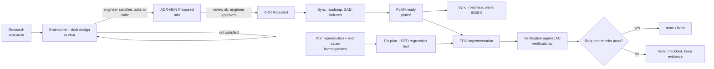

# Workflow: research → ADR → plan → implement → verify

Gates, approval and evidence: [`core/07-workflow-governance.md`](../core/07-workflow-governance.md).
Where files go and how they are named: [`core/08-repo-layout-and-naming.md`](../core/08-repo-layout-and-naming.md).
Language: [`core/09-language-and-communication.md`](../core/09-language-and-communication.md).
When installed, this file is copied to `.docs/workflow.md` in the target project and
templates live in `.agents/templates/`. Paths in skills are relative to the repo root.

## Flow

The engineer works with the agent **in the chat window until satisfied**; documents are
written only after that, so no tokens are spent on documents for unsettled ideas.

1. **Research** worth keeping → `research/subject-YYYYMMDD.md` (+ `research/spikes/`).
2. **The design draft stays in chat** until the engineer is satisfied. No separate design file.
3. **ADR** (`adr/ADR-NNN-slug.md`) = the SAD for one topic: context, options, decision,
   detailed design, diagrams, invariants. Created only when the engineer is satisfied.
   An ADR may be accepted before it is implemented.
4. Engineer reviews and **approves** → ADR `Accepted` → only then a concrete **PLAN**.
5. A roadmap (`plans/roadmap-*.md`) links ADRs when useful.
6. After every approval (ADR Accepted, PLAN ready/done) reflect it into the roadmap, SAD,
   indexes and related documents (table in governance section 5).

## Skills

| Stage | Skill | Output |
| --- | --- | --- |
| Large/unclear requirement (optional) | `requirement-discovery` | `requirements/REQ-*` |
| Research + design → ADR | `architecture-design` | `research/*`, then `adr/ADR-*` |
| Implementation plan | `implementation-planning` | `plans/PLAN-*` |
| Bug / crash / regression | `investigate-bugfix` | `investigations/INV-*` |
| Verify implementation / fix | `implementation-verification` | `verifications/VER-*` |
| SDK public API change (SDK/library repos) | `sdk-api-evolution` | Compatibility report, `CHANGELOG.md` Unreleased |
| SDK release (SDK/library repos) | `sdk-release` | `CHANGELOG.md`, `sdk/releases/`, `sdk/migrations/` |

`arch-designer` (system design with the 9 pillars and C4) is a design-method skill that
can be used inside `architecture-design`; it does not replace the gated flow.

## Artifacts

| Type | Location and ID | Status |
| --- | --- | --- |
| Research | `research/subject-YYYYMMDD.md` | draft (no gate) |
| Requirement (optional) | `requirements/REQ-YYYYMMDD-slug/{raw*,analysis}.md` | draft → analyzed; superseded/rejected |
| ADR | `adr/ADR-NNN-slug.md` + `adr/README.md` | Proposed → Accepted; Rejected; Superseded |
| Plan | `plans/PLAN-NNN-slug.md` + `plans/INDEX.md` | draft → ready → in-progress → done; blocked/abandoned |
| Investigation | `investigations/INV-YYYYMMDD-slug/{raw,report}.md` | open → root-caused → fixed; wontfix |
| Verification | `verifications/VER-YYYYMMDD-slug.md` | draft → running → passed/failed/blocked |

(All paths are under `.docs/` by default.) Raw files are immutable: keep wording, order
and typos; follow-ups go to `raw-002.md`, `raw-003.md`… Status changes after completion
are proposed with evidence, then written after the engineer confirms.

## Revision

`rev 0`. Only the engineer's confirmation bumps a revision; an approval points to an exact
snapshot.

## Revision history

- rev 0: (draft) generic workflow extracted from a production project; chat-first emphasis.
