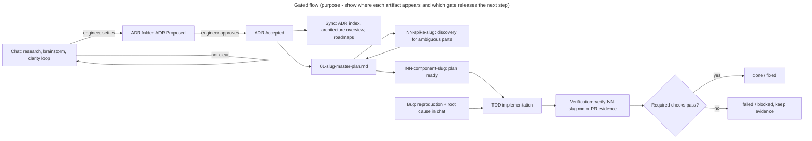

# Workflow: chat → ADR → plans → implement → verify

Gates, approval and evidence: [`core/07-workflow-governance.md`](../core/07-workflow-governance.md).
Clarity: [`core/11-clarity-first.md`](../core/11-clarity-first.md).
Where files go and how they are named: [`core/08-repo-layout-and-naming.md`](../core/08-repo-layout-and-naming.md).
Language: [`core/09-language-and-communication.md`](../core/09-language-and-communication.md).
When installed, this file is copied to `.agents/workflow.md` in the target project and
templates live in `.agents/templates/`. Artifact names below (ADR folder, plans folder,
technical roadmap…) resolve to paths through the project's **Docs layout** table in
`AGENTS.md`; the defaults are the Product Brain layout.

## Flow

The engineer works with the agent **in the chat window until every point is clear and
settled**; documents are written only after that.

1. **Chat first.** Research, brainstorm and design stay in chat until the engineer is
   satisfied and no point is ambiguous (`core/11`).
2. **ADR.** Create the ADR folder with the ADR (status `Proposed`); move research worth
   keeping into its research folder; contracts too large for the ADR go to
   `contract-<name>.md` in the ADR docs folder.
3. Engineer **approves** → ADR `Accepted` → sync the ADR index, the architecture
   overview and the roadmaps (governance §5).
4. **Master plan** `01-<slug>-master-plan.md` in the plans folder: splits the ADR into plans, one per
   component and outcome; ambiguous parts become discovery plans first.
5. **Plans** `NN-<component>-<slug>.md`, written only when clear; each follows the
   Accepted ADR and is executable by an agent that has never seen the repo.
6. **Bugfix:** reproduction and root cause settled in chat; the fix commit/PR records them;
   a regression test is the persisted evidence.
7. **Verify** against the AC before claiming done; propose status updates; sync the
   master plan and the roadmaps after confirmation.

## Skills

| Stage | Skill | Output |
| --- | --- | --- |
| Research + design → ADR | `architecture-design` | ADR folder |
| Master plan + plans | `implementation-planning` | Plans folder |
| Bug / crash / regression | `investigate-bugfix` | Chat evidence, regression test, fix commit/PR body |
| Verify implementation / fix | `implementation-verification` | `verify-NN-<slug>.md` in the ADR docs folder, or PR evidence |
| SDK public API change (SDK/library repos) | `sdk-api-evolution` | Compatibility report, `CHANGELOG.md` Unreleased |
| SDK release (SDK/library repos) | `sdk-release` | `CHANGELOG.md`, release notes, migration guides |

`arch-designer` (system design with the 9 pillars and C4) is a design-method skill that
can be used inside `architecture-design`; it does not replace the gated flow.

## Artifacts

| Type | Docs layout artifact (Product Brain default) | Status |
| --- | --- | --- |
| ADR | ADR folder + ADR index (`decisions/ADR-NNN-slug/`, `decisions/README.md`) | Proposed → Accepted; Rejected; Superseded |
| Research | Research folder (`<ADR folder>/.researchs/<subject>.md`) | no gate (written when the ADR is created) |
| Contract | ADR docs folder (`<ADR folder>/.docs/contract-<name>.md`) | follows the ADR |
| Master plan | Plans folder (`<ADR folder>/.plans/01-<slug>-master-plan.md`) | draft → active → done; paused/abandoned |
| Plan | Plans folder (`<ADR folder>/.plans/NN-<component>-<slug>.md`) | draft → ready → in-progress → done; blocked/abandoned |
| Verification | ADR docs folder (`<ADR folder>/.docs/verify-NN-<slug>.md`) | draft → running → passed/failed/blocked |
| Component card | Component cards (`components/<name>/README.md`) | updated when an ADR changes its interfaces |
| Roadmaps, architecture overview | `product-roadmap.md`, `technical-roadmap.md`, `architecture.md` | synced after approvals |

Status changes after completion are proposed with evidence, then written after the
engineer confirms.

## Revision

`rev 0`. Only the engineer's confirmation bumps a revision; an approval points to an exact
snapshot.

## Revision history

- rev 0: (draft) generic workflow extracted from a production project; chat-first emphasis.
- rev 0 (draft): Docs layout artifact names (Product Brain defaults), master plan + per-component plans, clarity loop,
  bugfix without INV files.
